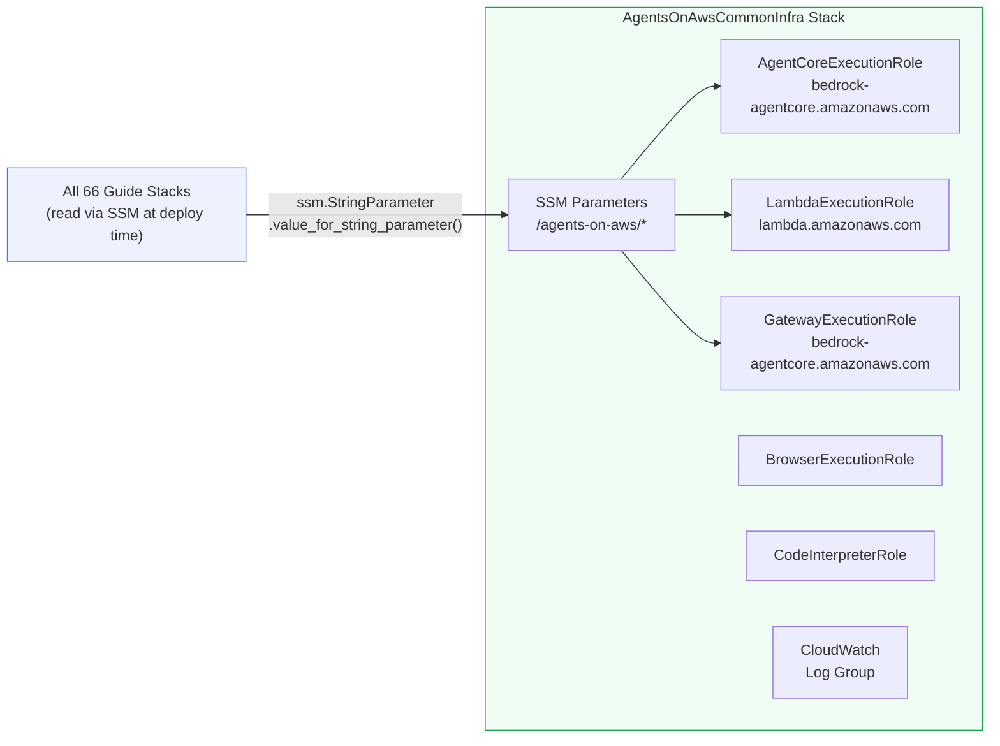
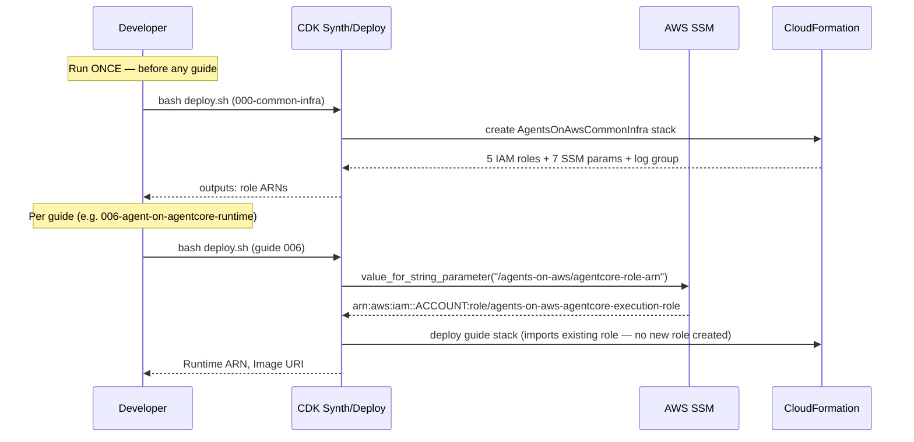
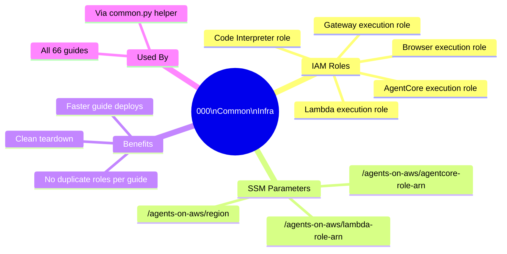

# 000 — Common Infrastructure

**Deploy this ONCE before running any other guide.**

This stack creates shared IAM roles and SSM parameters used by all 66 guides. Without it, each guide would create its own duplicate roles — adding 2–3 minutes to every `bash deploy.sh` and leaving orphaned IAM resources everywhere.

---

## What Gets Created

### IAM Roles

| Role Name | Principal | Used By |
|---|---|---|
| `agents-on-aws-agentcore-execution-role` | `bedrock-agentcore.amazonaws.com` | All Runtime agents (guides 006–066) |
| `agents-on-aws-lambda-execution-role` | `lambda.amazonaws.com` | Lambda guides (005, 021–027) |
| `agents-on-aws-gateway-execution-role` | `bedrock-agentcore.amazonaws.com` | Gateway resources (021–027) |
| `agents-on-aws-browser-execution-role` | `bedrock-agentcore.amazonaws.com` | Browser guides (037–041) |
| `agents-on-aws-code-interpreter-role` | `bedrock-agentcore.amazonaws.com` | Code Interpreter guides (042–045) |

> ⚠️ **Broad permissions by design.** This is a learning repo. All roles use broad permissions (`bedrock:*`, `bedrock-agentcore:*`) so you can focus on learning AgentCore features, not debugging IAM. In production, scope down to least-privilege.

### SSM Parameters

All guides read shared config via SSM at deploy time instead of hardcoding:

| Parameter | Value |
|---|---|
| `/agents-on-aws/agentcore-role-arn` | AgentCore execution role ARN |
| `/agents-on-aws/lambda-role-arn` | Lambda execution role ARN |
| `/agents-on-aws/gateway-role-arn` | Gateway execution role ARN |
| `/agents-on-aws/browser-role-arn` | Browser execution role ARN |
| `/agents-on-aws/code-interpreter-role-arn` | Code Interpreter role ARN |
| `/agents-on-aws/account-id` | Your AWS account ID |
| `/agents-on-aws/region` | `us-east-1` |

### CloudWatch Log Group

`/aws/agents-on-aws` — shared base log group. Each guide creates its own sub-group `/aws/agents-on-aws/NNN-guide-name`.

---

## Architecture

### Component Diagram



### Invocation Flow



### Guide Overview



---

## Steps

### Deploy (one-time)

```bash
source .venv/bin/activate
export JSII_SILENCE_WARNING_UNTESTED_NODE_VERSION=1

cd 00-foundations/000-common-infra
bash deploy.sh
```

Takes ~2 minutes. After it completes you'll see all role ARNs and SSM parameters printed.

### Verify the SSM parameters were created

```bash
aws ssm get-parameters-by-path \
  --path "/agents-on-aws" \
  --region us-east-1 \
  --query "Parameters[*].[Name,Value]" \
  --output table
```

### How guides use the shared roles

In every guide's `Infra/stacks/main_stack.py`:

```python
import sys, os

# Import the shared helpers
_COMMON = os.path.join(os.path.dirname(__file__),
    "../../../../00-foundations/000-common-infra/Infra/stacks")
sys.path.insert(0, _COMMON)

from common import get_agentcore_role, guide_log_group, PLATFORM

class MainStack(cdk.Stack):
    def __init__(self, ...):
        # Shared role — reads from SSM, no new role created
        role = get_agentcore_role(self)

        # Consistent platform — ARM64 for Mac + AgentCore
        image = ecr_assets.DockerImageAsset(
            self, "Image",
            directory=SOURCE_DIR,
            platform=PLATFORM,           # LINUX_ARM64
        )

        # Standard log group
        log_group = guide_log_group(self, "006-agent-on-agentcore-runtime")
```

## Cost Estimate

**Approximate cost: ~$0/month**

IAM roles are free. SSM Standard parameters (non-advanced) are free. CloudWatch log group is free until you write logs.

> For current pricing, see the [AgentCore pricing page](https://aws.amazon.com/bedrock/agentcore/pricing/) and [Bedrock pricing](https://aws.amazon.com/bedrock/pricing/). Always run `bash destroy.sh` after testing to stop billing.

## Cleanup

⚠️ **Only destroy after destroying ALL guide stacks first.**

```bash
bash destroy.sh    # prompts for 'yes' — will fail if guides are still deployed
```

## Key Takeaways

- Deploy once, reuse across all 66 guides — no duplicate IAM roles
- Guides read role ARNs via SSM at CDK synthesis time (`value_for_string_parameter`)
- `common.py` provides `get_agentcore_role()`, `PLATFORM`, and `guide_log_group()` helpers
- `PLATFORM = LINUX_ARM64` matches AgentCore Runtime and Apple Silicon Macs
- All Dockerfiles use `FROM --platform=linux/arm64 python:3.11-slim-bookworm`

## Next Steps

- [`001-prerequisites`](../001-prerequisites/) — verify your setup
- [`003-local-agent-strands`](../003-local-agent-strands/) — run your first agent locally
- [`006-agent-on-agentcore-runtime`](../../01-runtime/006-agent-on-agentcore-runtime/) — first Runtime deploy using these shared roles
