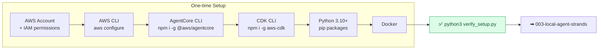
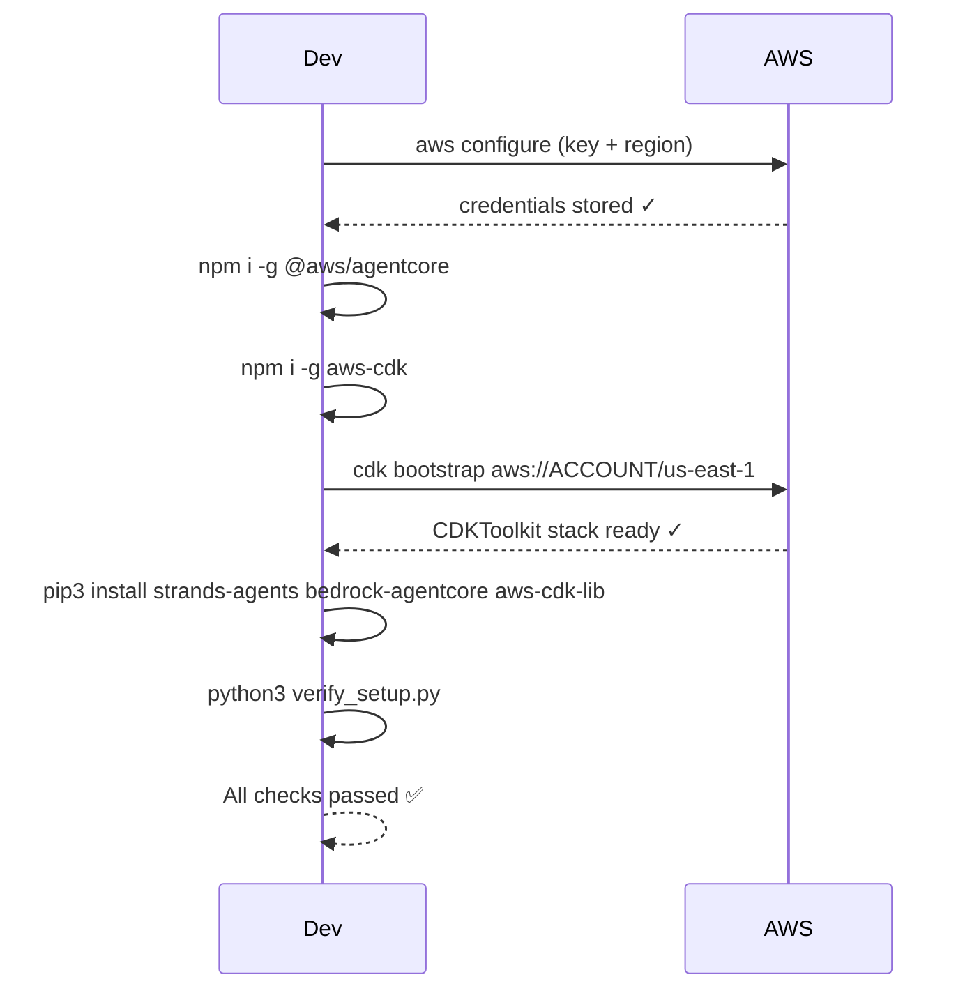
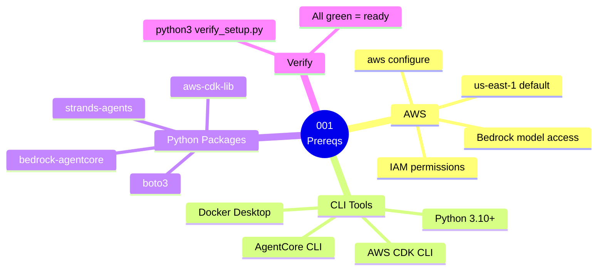

# 001 — Prerequisites & Setup

Before you run any guide in this repo, complete the steps below. This is a one-time setup.

---

## 1. AWS Account & Permissions

You need an AWS account with permissions to use Amazon Bedrock AgentCore.

### Minimum IAM Permissions

Attach the following policies to your IAM user or role:

```json
{
  "Version": "2012-10-17",
  "Statement": [
    {
      "Sid": "AgentCoreFullAccess",
      "Effect": "Allow",
      "Action": [
        "bedrock-agentcore:*",
        "bedrock-agentcore-control:*"
      ],
      "Resource": "*"
    },
    {
      "Sid": "BedrockModelAccess",
      "Effect": "Allow",
      "Action": [
        "bedrock:InvokeModel",
        "bedrock:InvokeModelWithResponseStream"
      ],
      "Resource": "*"
    },
    {
      "Sid": "SupportingServices",
      "Effect": "Allow",
      "Action": [
        "ecr:*",
        "iam:CreateRole",
        "iam:AttachRolePolicy",
        "iam:PassRole",
        "lambda:*",
        "logs:*",
        "cloudwatch:*",
        "s3:*",
        "cognito-idp:*",
        "sts:AssumeRole"
      ],
      "Resource": "*"
    }
  ]
}
```

> For production, scope these down. For learning purposes, using `AdministratorAccess` on a dedicated sandbox account is acceptable.

### Enable Bedrock Model Access

1. Open the [Amazon Bedrock console](https://console.aws.amazon.com/bedrock/) in `us-east-1`
2. Go to **Model Access** → **Manage model access**
3. Enable at minimum:
   - `Amazon Nova Pro` (`us.amazon.nova-pro-v1:0`)
   - `Anthropic Claude 3.5 Sonnet` (used in some guides)
4. Click **Save changes** — activation takes 1–5 minutes

---

## 2. AWS CLI

```bash
# Install (macOS)
brew install awscli

# Configure
aws configure
# AWS Access Key ID: <your-key>
# AWS Secret Access Key: <your-secret>
# Default region name: us-east-1
# Default output format: json

# Verify
aws sts get-caller-identity
```

Expected output:
```json
{
  "UserId": "AIDAXXXXXXXXXXXXXXXXX",
  "Account": "123456789012",
  "Arn": "arn:aws:iam::123456789012:user/your-user"
}
```

---

## 3. Python 3.10+

```bash
# Check version
python3 --version   # must be 3.10 or higher

# macOS via homebrew
brew install python@3.11

# Install pip if missing
python3 -m ensurepip --upgrade
```

---

## 4. Node.js 20+

Required for the AgentCore CLI.

```bash
# Check version
node --version   # must be v20 or higher

# macOS via homebrew
brew install node@20

# Or via nvm
nvm install 20 && nvm use 20
```

---

## 5. AgentCore CLI

```bash
npm install -g @aws/agentcore

# Verify
agentcore --version
```

---

## 6. AWS CDK

```bash
npm install -g aws-cdk

# Verify
cdk --version   # should be 2.x

# Bootstrap CDK in us-east-1 (one-time per account/region)
cdk bootstrap aws://YOUR_ACCOUNT_ID/us-east-1
```

Replace `YOUR_ACCOUNT_ID` with your 12-digit AWS account ID.

---

## 7. Docker

Required for guides that deploy to AgentCore Runtime (guides 006+).

```bash
# macOS: install Docker Desktop from https://docs.docker.com/desktop/mac/install/

# Verify
docker --version
docker ps   # should not error
```

---

## 8. Python Virtual Environment (shared across all guides)

All 66 guides use **one shared virtual environment** at the repo root. Create it once — that's it.

```bash
# From the repo root (aws-bedrock-agentcore/)
bash setup-env.sh
```

This creates `.venv/`, activates it, and installs all packages.

**Activate at the start of every terminal session:**

```bash
# From anywhere inside the repo
source .venv/bin/activate

# Your prompt will show (.venv) to confirm it's active
# (.venv) ❯
```

**Why one shared venv?**

- All guides use the same core packages (`strands-agents`, `bedrock-agentcore`, `boto3`, `aws-cdk-lib`)
- No re-installing packages per guide
- CDK commands (`cdk deploy`) and `agentcore` commands all use the same Python
- Consistent, reproducible across the whole learning journey

---

## 9. Python Packages (installed by setup-env.sh)

The `setup-env.sh` script installs all of these automatically:

```bash
# Core
strands-agents==1.57.2
bedrock-agentcore==1.24.0
boto3==1.38.0

# CDK (must be >= 2.243.0 for aws_bedrockagentcore constructs)
"aws-cdk-lib>=2.243.0"
constructs>=10.0.0

# MCP, HTTP, OTEL, Playwright, LangGraph, CrewAI
# (full list in requirements.txt at repo root)
```

If you prefer to install manually:

```bash
source .venv/bin/activate
pip3 install -r requirements.txt
```

---

## 10. Verify Everything

Run the verification script **inside the activated venv**:

```bash
source .venv/bin/activate          # activate first
cd 00-foundations/001-prerequisites
python3 verify_setup.py
```

You should see all green checkmarks.

---

## 10. Region Note

All guides use **`us-east-1`** as the default region. Check [AgentCore regional availability](https://docs.aws.amazon.com/bedrock-agentcore/latest/devguide/agentcore-regions.html) before using another region.

---


## Cost Estimate

**Approximate cost: ~$0**

No AWS resources deployed. Bedrock model calls for setup verification only: <$0.01.

> For current pricing, see the [AgentCore pricing page](https://aws.amazon.com/bedrock/agentcore/pricing/) and [Bedrock pricing](https://aws.amazon.com/bedrock/pricing/). Always run `bash destroy.sh` after testing to stop billing.
## Cleanup

No AWS resources are deployed in this guide.


## Architecture

### Component Diagram



### Invocation Flow



### Guide Overview



---
