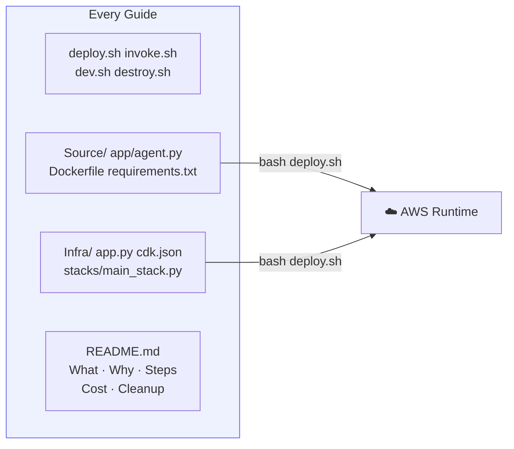
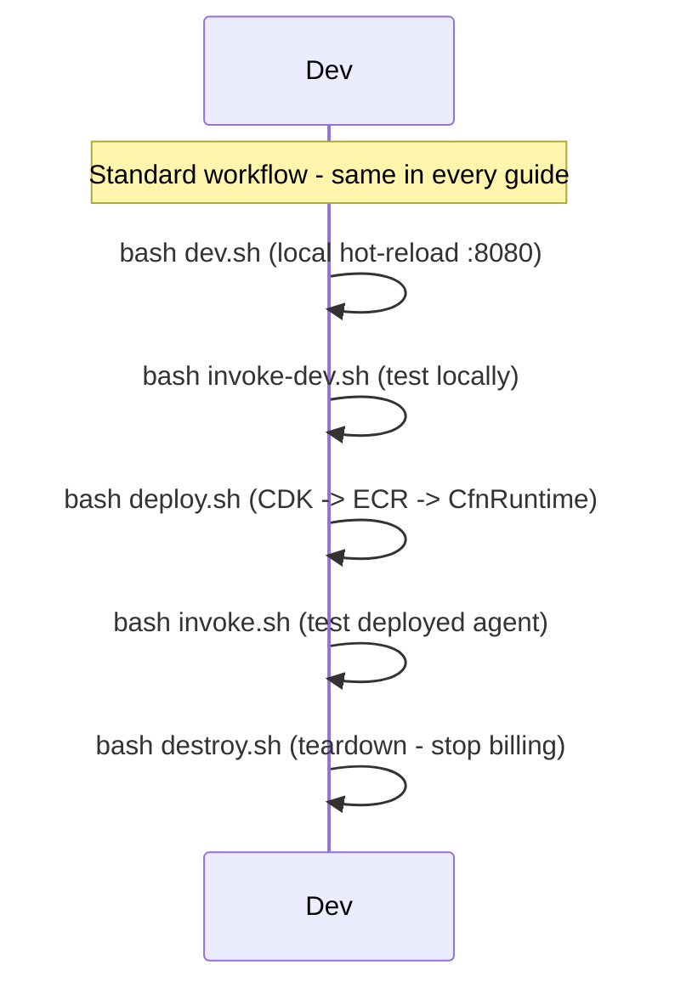
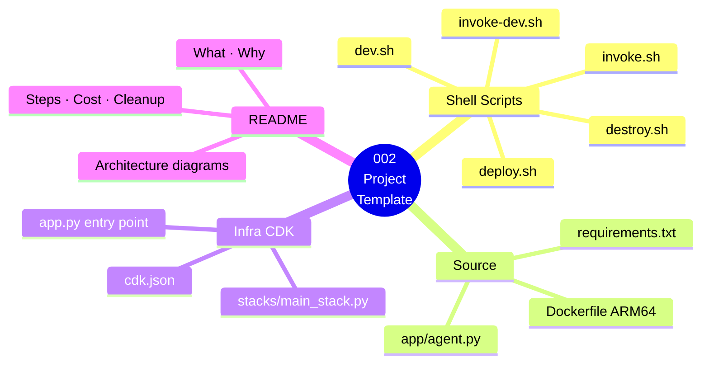

# 002 — Project Template

This guide defines the **standard structure** every guide in this repo follows. Use it as a reference when contributing a new guide or adapting code to your own project.

---

## Directory Layout

```
NNN-guide-name/
├── README.md        ← What, Why, Steps, Cleanup, Cost Estimate
├── deploy.sh        ← Deploy all AWS resources (CDK + AgentCore)
├── invoke.sh        ← Invoke the deployed agent
├── invoke-dev.sh    ← Invoke the local dev server
├── dev.sh           ← Start the AgentCore local dev server (hot reload)
├── destroy.sh       ← Tear down all AWS resources
├── Source/
│   ├── app/
│   │   ├── __init__.py
│   │   ├── agent.py           ← Main agent entry point
│   │   └── tools/
│   │       ├── __init__.py
│   │       └── my_tool.py     ← Individual tool implementations
│   ├── requirements.txt
│   └── Dockerfile             ← (Runtime guides only)
└── Infra/
    ├── app.py                 ← CDK app entry point
    ├── cdk.json
    ├── requirements.txt
    └── stacks/
        ├── __init__.py
        └── main_stack.py      ← The CDK stack
```

---

## Shell Scripts

Every guide uses plain shell scripts — no Make required:

| Script | Command | Description |
|--------|---------|-------------|
| `deploy.sh` | `bash deploy.sh` | Deploy all AWS resources (CDK + AgentCore) |
| `invoke.sh` | `bash invoke.sh` | Invoke the deployed agent with a test prompt |
| `invoke-dev.sh` | `bash invoke-dev.sh` | Invoke the local dev server (requires `dev.sh` running) |
| `dev.sh` | `bash dev.sh` | Start AgentCore local dev server with hot reload |
| `destroy.sh` | `bash destroy.sh` | Tear down all AWS resources |

**Install dependencies manually (one-time):**
```bash
pip3 install -r Source/requirements.txt   # agent runtime deps
pip3 install -r Infra/requirements.txt    # CDK deps
```

**Clean up local build artifacts:**
```bash
rm -rf Infra/cdk.out __pycache__ .pytest_cache
```

---

## CDK Stack Pattern

All infrastructure stacks follow this pattern:

```python
# Infra/stacks/main_stack.py
import aws_cdk as cdk
from constructs import Construct

class MainStack(cdk.Stack):
    def __init__(self, scope: Construct, construct_id: str, **kwargs) -> None:
        super().__init__(scope, construct_id, **kwargs)
        # Resources defined here
```

```python
# Infra/app.py
import aws_cdk as cdk
from stacks.main_stack import MainStack

app = cdk.App()
MainStack(
    app,
    "GuideNNN",           # Stack name — change per guide
    env=cdk.Environment(
        account=app.node.try_get_context("account") or os.environ["CDK_DEFAULT_ACCOUNT"],
        region="us-east-1",
    ),
)
app.synth()
```

```json
// Infra/cdk.json
{
  "app": "python3 app.py"
}
```

---

## Agent Entry Point Pattern

All Runtime agents wrap with `BedrockAgentCoreApp`:

```python
# Source/app/agent.py
from strands import Agent, tool
from bedrock_agentcore import BedrockAgentCoreApp

@tool
def my_tool(input: str) -> str:
    """Tool description shown to the model."""
    return f"Result for: {input}"

app = BedrockAgentCoreApp()

@app.entrypoint
def invoke(payload: dict) -> dict:
    agent = Agent(
        model="us.amazon.nova-pro-v1:0",
        system_prompt="You are a helpful assistant.",
        tools=[my_tool],
    )
    response = agent(payload.get("prompt", "Hello"))
    return {"response": str(response)}

if __name__ == "__main__":
    app.run()   # Starts uvicorn on port 8080
```

---

## README Template

Each guide's README follows this structure:

```markdown
# NNN — Guide Title

## What
One sentence.

## Why
Why this feature matters and when you'd use it.

## Architecture

### Component Diagram



### Invocation Flow



### Guide Overview



---
## Prerequisites
Any guide-specific requirements beyond 002-prerequisites.

## Steps
### 1. ...
### 2. ...
### 3. ...

## Test It
How to verify it works.


## Cost Estimate

**Approximate cost: ~$0**

Documentation only. No resources deployed.

> For current pricing, see the [AgentCore pricing page](https://aws.amazon.com/bedrock/agentcore/pricing/) and [Bedrock pricing](https://aws.amazon.com/bedrock/pricing/). Always run `bash destroy.sh` after testing to stop billing.
## Cleanup
`bash destroy.sh` or specific CDK/CLI commands.

## Key Takeaways
3–5 bullet points of what you learned.

## Next Steps
Links to the next guide(s).
```

---

## No Resources Deployed

This guide is documentation-only. Nothing to deploy or destroy.
