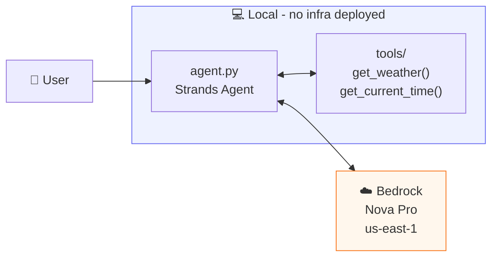
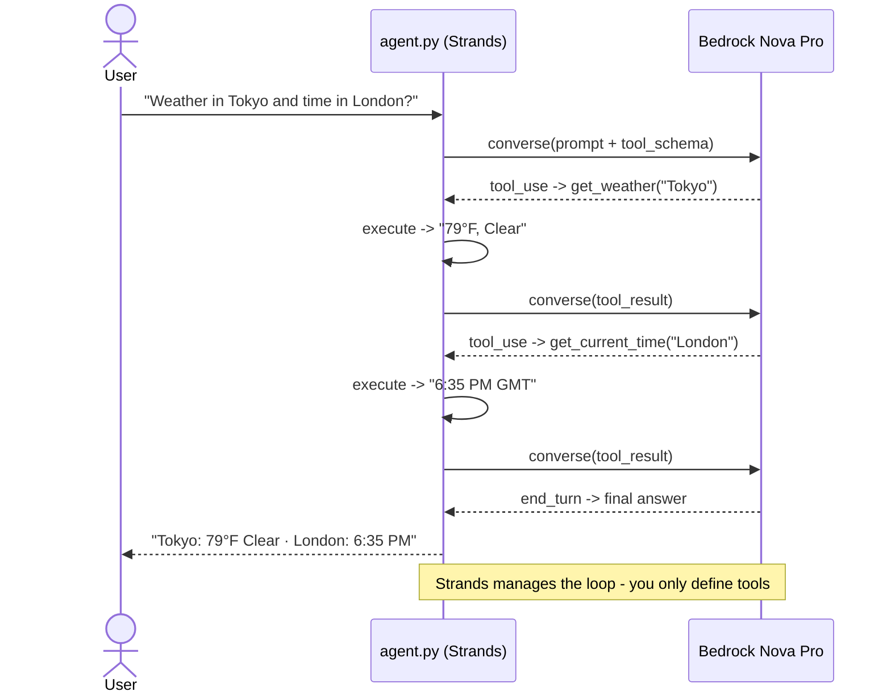
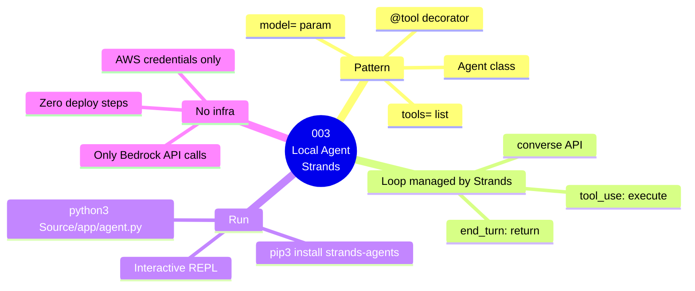

# 003 — Local Agent with Strands

## What

Build and run a fully functional AI agent on your local machine using the [Strands Agents](https://strandsagents.com) framework and Amazon Bedrock. No AWS infrastructure required — just Python and your AWS credentials.

## Why

Before deploying anything to the cloud, you need to understand what an agent actually does. An agent is a loop:

```
User prompt → Model reasons → Model calls a tool → Tool returns result → Model reasons again → Final answer
```

Strands makes this loop simple. This guide shows that loop in action with two real tools, before any framework complexity gets in the way.

## Architecture

### Component Diagram



### Invocation Flow



### Guide Overview



---
## Prerequisites

- Completed [`001-prerequisites`](../../001-prerequisites/README.md)
- No Docker, no CDK needed

## Steps

### 1. Install dependencies

```bash
cd 003-local-agent-strands
pip3 install -r Source/requirements.txt
```

### 2. Run the agent

```bash
python3 Source/app/agent.py
```

### 3. Try some prompts

The agent starts an interactive loop. Try:

```
You: What's the weather like in Austin, TX?
You: What time is it in Tokyo right now?
You: I'm planning a trip to London. What's the weather and what time is it there?
You: quit
```

The third prompt forces the agent to call **both tools** in sequence — watch it reason through which tools to call.

### 4. Understand what happened

Look at the output. You'll see:
- The agent received your prompt
- It decided which tool(s) to call
- It called them and got results
- It composed a final answer

That reasoning loop is the heart of every agent in this entire guide series.

## Test It

```bash
python3 Source/app/agent.py
```

Expected: The agent answers weather and time questions correctly by calling tools.


## Cost Estimate

**Approximate cost: ~$0.01–$0.05/run**

Bedrock Nova Pro: ~$0.0008/1K input tokens, ~$0.0024/1K output tokens. A typical 10-prompt session costs under $0.05. No infrastructure deployed.

> For current pricing, see the [AgentCore pricing page](https://aws.amazon.com/bedrock/agentcore/pricing/) and [Bedrock pricing](https://aws.amazon.com/bedrock/pricing/). Always run `bash destroy.sh` after testing to stop billing.
## Cleanup

No AWS resources deployed. Nothing to clean up.

## Key Takeaways

- An agent is a reasoning loop: think → tool → think → answer
- Strands `@tool` decorator turns any Python function into a model-callable tool
- The model (Nova Pro) decides **when** to call a tool based on the user's intent
- You don't write the loop — Strands manages it
- Amazon Bedrock provides the model; no OpenAI key needed

## Next Steps

- [`004-local-agent-no-framework`](../../004-local-agent-no-framework/) — Build the same agent from scratch with raw boto3 to see what Strands does under the hood
- [`006-agent-on-agentcore-runtime`](../../006-agent-on-agentcore-runtime/) — Deploy this exact agent to AgentCore Runtime
