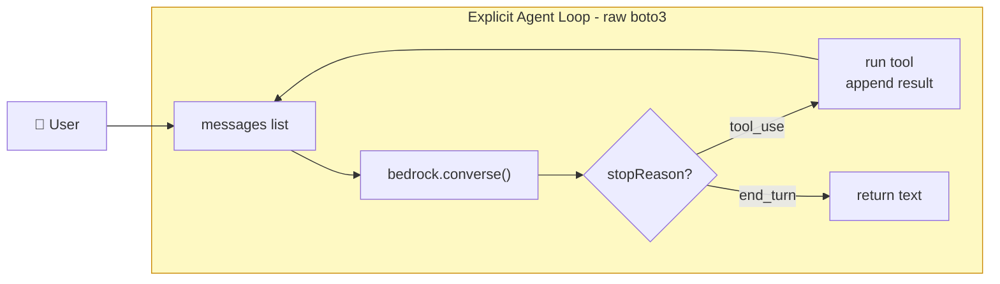
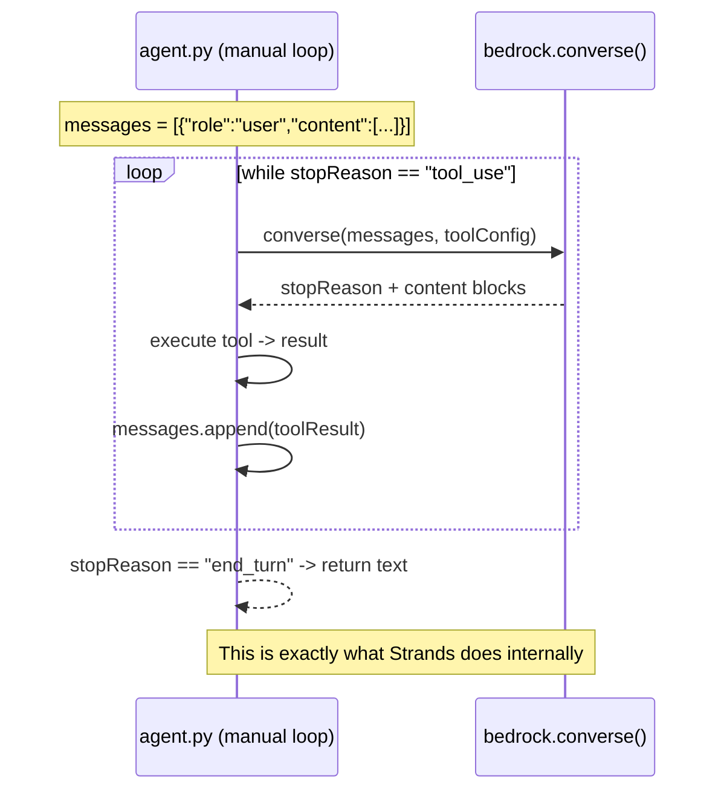
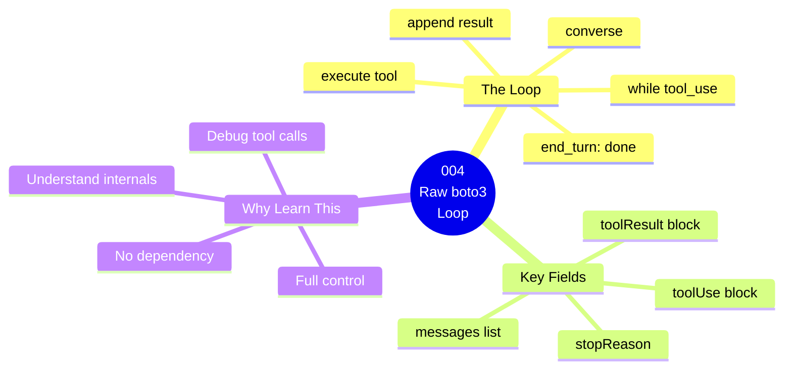

# 004 — Local Agent with Raw boto3 (No Framework)

## What

Build the same agent as guide 003, but using **only boto3 and the Bedrock Converse API** — no Strands, no LangChain, no framework at all.

## Why

Every agent framework — Strands, LangGraph, CrewAI — implements the same underlying loop. Seeing the loop in raw Python makes it crystal clear what these frameworks are doing for you. Once you understand the loop, you'll understand every framework.

The loop is:
```
while model wants to call tools:
    call model
    if stop_reason == "tool_use":
        execute each requested tool
        add results to messages
    elif stop_reason == "end_turn":
        return the text → done
```

## Architecture

### Component Diagram



### Invocation Flow



### Guide Overview



---
## Prerequisites

- Completed [`001-prerequisites`](../../001-prerequisites/README.md)

## Steps

### 1. Install

```bash
cd 004-local-agent-no-framework
pip3 install -r Source/requirements.txt
```

### 2. Run

```bash
python3 Source/app/agent.py "What's the weather in Seattle and what time is it there?"
```

Watch the verbose output — you'll see each iteration of the loop, which tool is called, and what it returns.

### 3. Compare to Guide 003

Notice that the output is identical to guide 003, but now you can see exactly:
- The `messages` list growing with each turn
- The `stop_reason: "tool_use"` vs `"end_turn"` decisions
- The raw JSON the model sends back when requesting a tool

## Test It

```bash
python3 Source/app/agent.py "What's the weather in Seattle and what time is it there?"
```

Expected: verbose loop output showing 2 tool calls, then a final answer.


## Cost Estimate

**Approximate cost: ~$0.01–$0.05/run**

Bedrock Nova Pro: ~$0.0008/1K input, ~$0.0024/1K output. No infrastructure deployed.

> For current pricing, see the [AgentCore pricing page](https://aws.amazon.com/bedrock/agentcore/pricing/) and [Bedrock pricing](https://aws.amazon.com/bedrock/pricing/). Always run `bash destroy.sh` after testing to stop billing.
## Cleanup

No AWS resources deployed.

## Key Takeaways

- The Bedrock Converse API's `stopReason` field drives the agent loop
- `tool_use` → execute tools and feed results back; `end_turn` → done
- The `messages` list is the agent's entire working memory within a session
- A framework like Strands removes the boilerplate but doesn't change the fundamentals
- Tool schemas (JSON) are how you expose Python functions to the model

## Next Steps

- [`005-agent-on-lambda`](../../005-agent-on-lambda/) — Deploy this agent to Lambda (and see why Runtime is better)
- [`006-agent-on-agentcore-runtime`](../../006-agent-on-agentcore-runtime/) — The right way to host an agent in AWS
