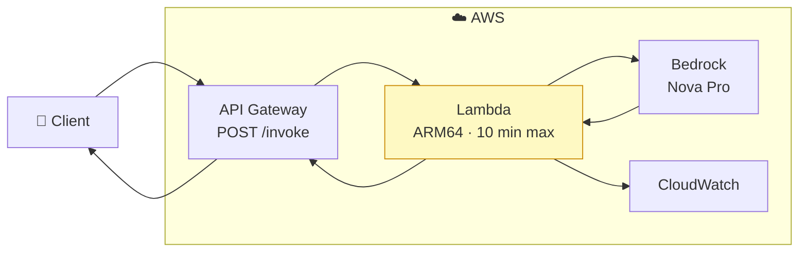
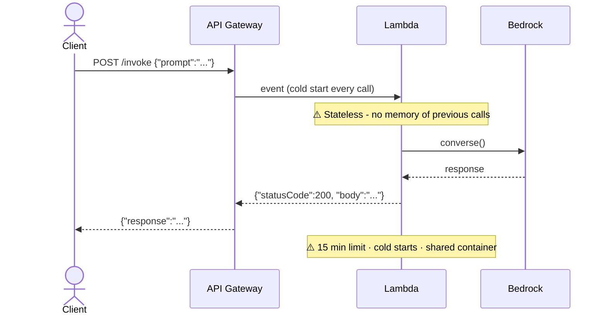
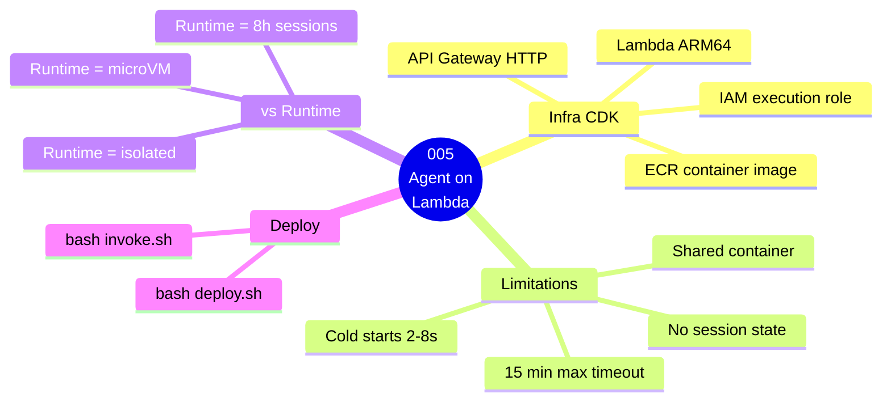

# 005 — Agent on Lambda

## What

Deploy the Strands agent from guide 003 as an **AWS Lambda function** exposed through an **API Gateway HTTP API**. Invoke it with a POST request.

## Why

Lambda is the most common first step when "serverless-ifying" an agent. This guide deploys it on Lambda to show both **how it works** and **what its limitations are** — limitations that AgentCore Runtime is specifically designed to solve.

### Lambda limitations for agents

| Limitation | Impact |
|------------|--------|
| 15-minute max execution | Long-running agents time out |
| No session state between invocations | Each call is cold — agent forgets context |
| Cold start adds latency | First user request is slow |
| One container shared per concurrent invocation | No true isolation between users |
| No persistent filesystem | Agent can't write files across turns |

Guide 006 shows how AgentCore Runtime solves all of these.

## Architecture

### Component Diagram



### Invocation Flow



### Guide Overview



---
## Prerequisites

- Completed [`001-prerequisites`](../../001-prerequisites/README.md)
- Docker installed and running (Lambda uses container image)

## Steps

### 1. Deploy (~5 min)

```bash
bash deploy.sh
```

CDK builds the ARM64 container, pushes to ECR, deploys Lambda + API Gateway.

### 2. Invoke

```bash
bash invoke.sh
```

### 3. Test locally — Lambda RIE (optional)

Lambda local testing uses the **Lambda Runtime Interface Emulator (RIE)**, not `agentcore dev`.
`agentcore dev` is only for AgentCore Runtime guides (006+) that use `BedrockAgentCoreApp`.

```bash
# Terminal 1 — build image and start RIE on port 9000
bash dev.sh

# Terminal 2 — invoke via RIE
bash test-local.sh
```

### 4. Observe the stateless limitation

Call twice to see Lambda's key limitation:

```bash
API_URL=$(aws cloudformation describe-stacks \
  --stack-name Guide005AgentOnLambda --region us-east-1 \
  --query 'Stacks[0].Outputs[?OutputKey==`ApiUrl`].OutputValue' \
  --output text)

# Call 1 — introduce yourself
curl -s -X POST "$API_URL" -H "Content-Type: application/json" \
  -d '{"prompt": "My name is Anvesh"}' | python3 -m json.tool

# Call 2 — Lambda forgot you
curl -s -X POST "$API_URL" -H "Content-Type: application/json" \
  -d '{"prompt": "What is my name?"}' | python3 -m json.tool
```

The agent says "I don't know your name." on the second call.
**Guide 006 (AgentCore Runtime) solves this.**
3. Deploy Lambda + API Gateway via CDK
4. Print the API Gateway URL

## Cost Estimate

**Approximate cost: ~$0.01–$0.05/month light testing**

Lambda: $0.20/1M requests + duration; API Gateway: $1.00/1M calls; ECR: $0.10/GB/month; Nova Pro: ~$0.001/call. 50 test calls ≈ $0.01.

> For current pricing, see the [AgentCore pricing page](https://aws.amazon.com/bedrock/agentcore/pricing/) and [Bedrock pricing](https://aws.amazon.com/bedrock/pricing/). Always run `bash destroy.sh` after testing to stop billing.
## Cleanup

```bash
bash destroy.sh
```

## Key Takeaways

- Lambda can run a Strands agent with minimal changes (just wrap in `handler()`)
- Lambda's 15-min timeout and statelessness are real constraints for agents
- No session isolation — all calls share the same Lambda environment (per concurrent instance)
- Cold starts add 2–8 seconds for the first call
- These limitations are why AgentCore Runtime exists

## Next Steps

- [`006-agent-on-agentcore-runtime`](../../006-agent-on-agentcore-runtime/) — The right way to host an agent in AWS — solves all of Lambda's limitations
