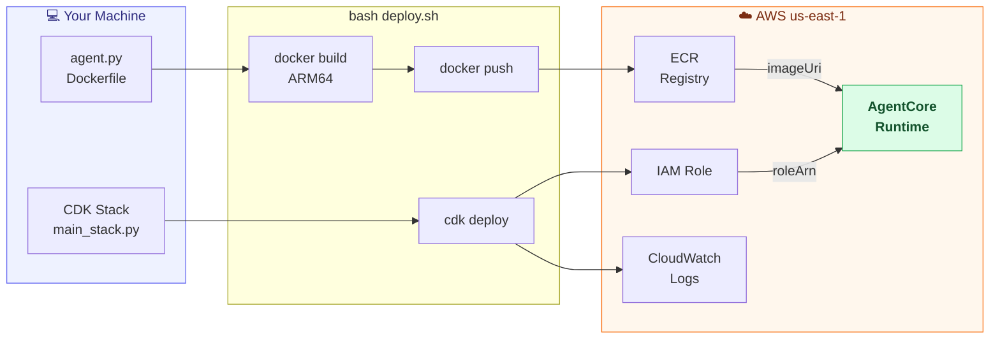
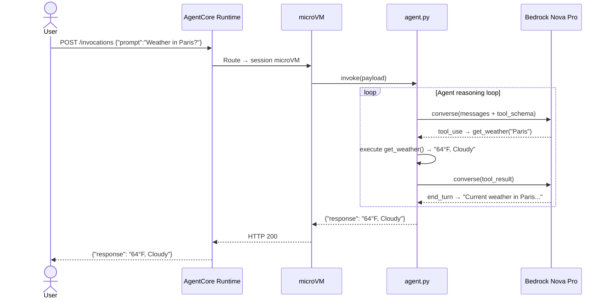
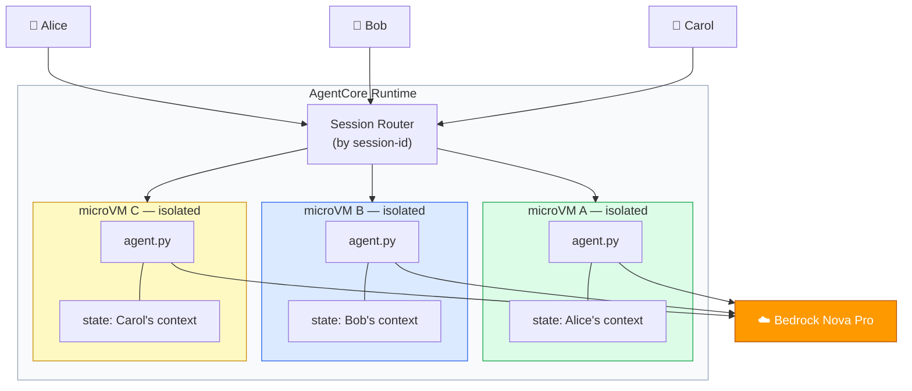
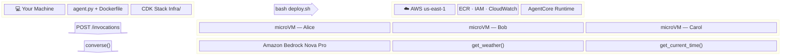
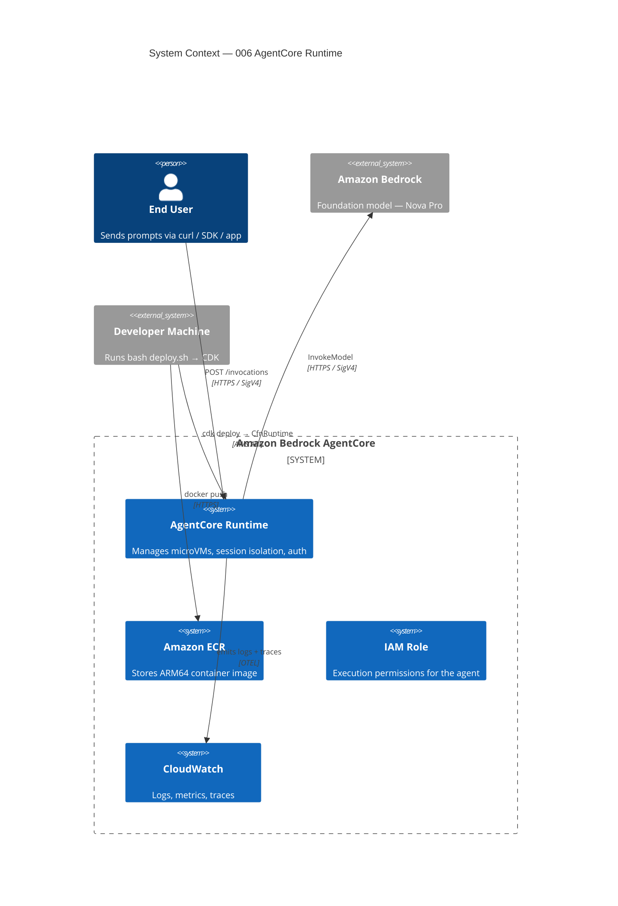
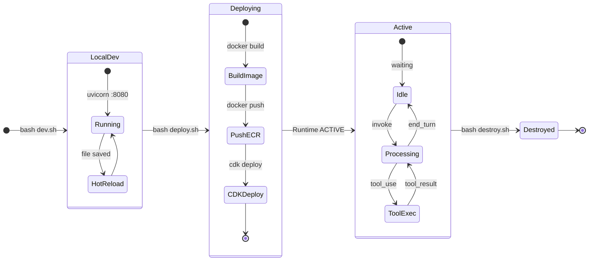
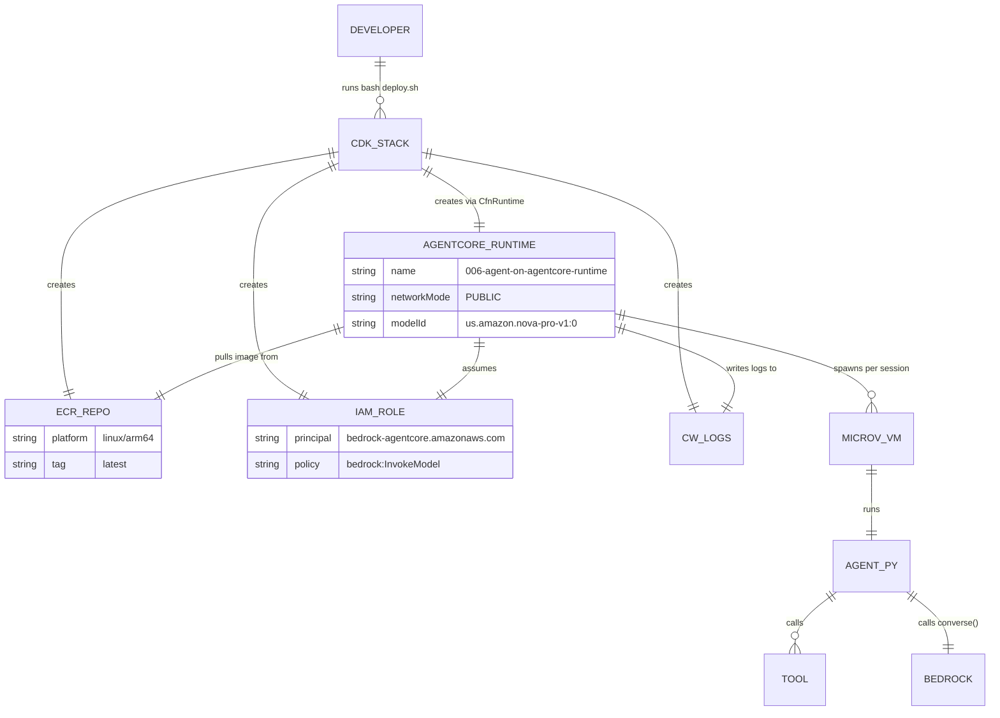
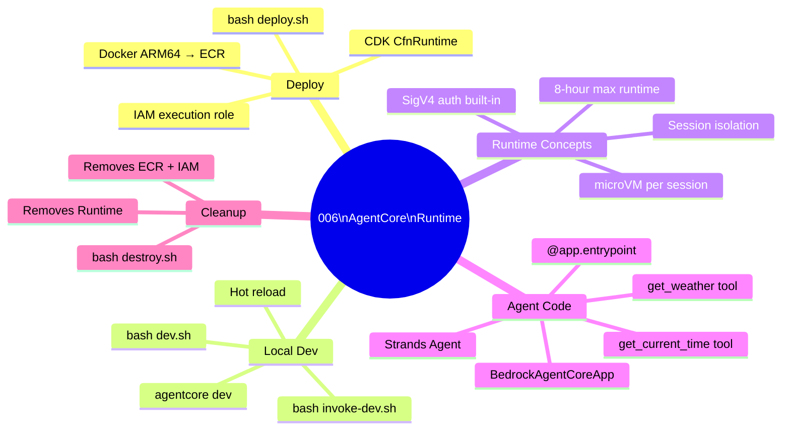

# 006 — Diagram Showcase (All Options)

All diagram types for guide 006 (Agent on AgentCore Runtime).
Compare them side by side and pick your preferred style.

---

## Option 1A — Mermaid `flowchart LR` (Deployment Pipeline)

Shows how code flows from your laptop to a running Runtime agent.
**Best for:** infrastructure pipelines, component relationships.



---

## Option 1B — Mermaid `sequenceDiagram` (Invocation Flow)

Shows the runtime round-trip from user prompt to response.
**Best for:** request/response flows, protocol interactions, agent reasoning loops.



---

## Option 1C — Mermaid `flowchart TB` (Session Isolation)

Shows the microVM-per-session model.
**Best for:** multi-user isolation, parallel execution, state boundaries.



---

## Option 2 — Mermaid `block` (System Layer Overview)

Shows the system in layered blocks — local → deploy → cloud → execution → model.
**Best for:** high-level architecture overviews at the top of a README.



---

## Option 3 — Mermaid `C4Context` (Architecture View)

C4 model system context — shows actors, system boundaries, and external dependencies.
**Best for:** enterprise documentation, architecture review boards.



---

## Option 4 — Mermaid `stateDiagram-v2` (Lifecycle)

Shows state transitions from local dev → deploy → running → destroyed.
**Best for:** session lifecycle, async workflows, state machines.



---

## Option 5 — ASCII / Plain-text Art

Pure text boxes and arrows — renders everywhere: GitHub, terminals, raw text, offline.
**Best for:** terminal-friendly docs, universal compatibility, no rendering dependency.

```
┌──────────────────────────────────────────────────────────────────────┐
│                     006 — AgentCore Runtime                          │
└──────────────────────────────────────────────────────────────────────┘

  DEPLOY                                INVOKE
  ──────                                ──────

  💻 Your Machine                       👤 User
       │                                    │
       │  bash deploy.sh                    │  POST /invocations
       ▼                                    ▼
  ┌──────────┐  imageUri  ┌──────────────────────────────────────┐
  │  Amazon  │───────────▶│         AgentCore Runtime            │
  │   ECR    │            │                                      │
  └──────────┘            │  ┌──────────────┐ ┌──────────────┐  │
                          │  │  microVM A   │ │  microVM B   │  │
  ┌──────────┐  roleArn   │  │  (Alice)     │ │  (Bob)       │  │
  │  IAM     │───────────▶│  │  agent.py    │ │  agent.py    │  │
  │  Role    │            │  └──────┬───────┘ └──────┬───────┘  │
  └──────────┘            └─────────┼────────────────┼──────────┘
                                    │                │
                                    ▼                ▼
                           ┌──────────────────────────────┐
                           │      Amazon Bedrock           │
                           │      Nova Pro                 │
                           │  ┌────────────────────────┐  │
                           │  │   Agent Loop            │  │
                           │  │   1. converse()         │  │
                           │  │   2. tool_use           │  │
                           │  │   3. execute tool       │  │
                           │  │   4. converse()         │  │
                           │  │   5. end_turn → done    │  │
                           │  └────────────────────────┘  │
                           └──────────────────────────────┘
```

---

## Option 6 — HTML `<picture>` + SVG

Full visual control with exported SVG — renders everywhere, dark mode support.
**Best for:** pixel-perfect diagrams, brand-consistent docs.
**Downside:** requires exporting from draw.io / Excalidraw / Lucidchart, and committing SVG files.

```html
<!-- Paste this directly into your README.md -->
<picture>
  <source media="(prefers-color-scheme: dark)"
          srcset="./diagrams/arch-dark.svg">
  
</picture>
```

> SVG files live in a `diagrams/` folder next to the README.
> Export from [draw.io](https://draw.io), [Excalidraw](https://excalidraw.com),
> or [Lucidchart](https://lucidchart.com) as SVG (not PNG — SVG is crisp at any zoom).

---

## Option 7 — Mermaid `erDiagram` (Resource Map)

Shows how AWS resources relate to each other — like an ER diagram but for infrastructure.
**Best for:** showing what CDK creates and how resources connect.



---

## Option 8 — Mermaid `mindmap` (Concepts at a Glance)

Shows all topics covered in the guide as a visual TOC.
**Best for:** quick orientation, study guides, concept maps.



---

## Comparison Table

| # | Type | GitHub renders? | Extra tooling? | Best for |
|---|------|:-:|:-:|---|
| 1A | `flowchart LR` | ✅ | None | Deployment pipelines, component maps |
| 1B | `sequenceDiagram` | ✅ | None | Request flows, agent reasoning loops |
| 1C | `flowchart TB` | ✅ | None | Isolation, parallel components |
| 2  | `block`          | ✅ | None | Layered system overview |
| 3  | `C4Context`      | ✅ | None | Enterprise architecture docs |
| 4  | `stateDiagram-v2`| ✅ | None | Lifecycle, state machines |
| 5  | ASCII art        | ✅ everywhere | None | Terminal-friendly, universal |
| 6  | HTML + SVG       | ✅ | draw.io / Excalidraw | Pixel-perfect, branded |
| 7  | `erDiagram`      | ✅ | None | Resource relationships |
| 8  | `mindmap`        | ✅ | None | Guide concepts at a glance |

---

## Recommended Combination (adopted across all 66 guides)

1. **Option 1A `flowchart LR`** — Architecture section, shows the deployment + component view
2. **Option 1B `sequenceDiagram`** — Invocation Flow section, shows what happens at runtime
3. **Option 8 `mindmap`** — Guide Overview section, visual concept map

All three are Mermaid, render natively on GitHub, and require zero extra tooling.
