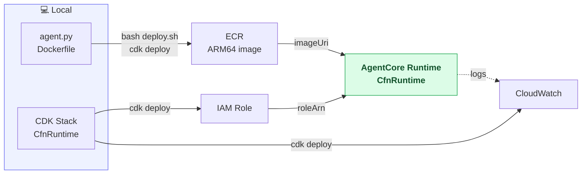
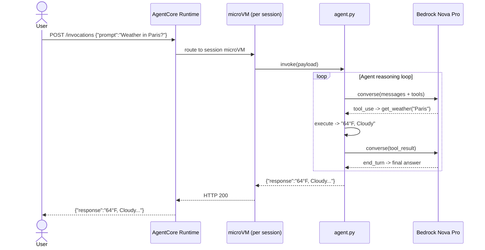
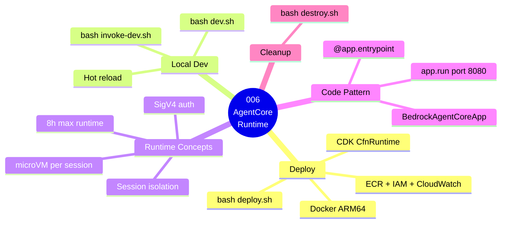

# 006 — Agent on AgentCore Runtime

## What

Deploy the Strands travel agent from guide 003 to **Amazon Bedrock AgentCore Runtime** — the purpose-built serverless hosting environment for AI agents. Run it locally first, then push it to the cloud with a single command.

## Why

This is the guide where everything clicks. AgentCore Runtime is NOT just "Lambda for agents" — it's a fundamentally different execution model:

| | Lambda (005) | AgentCore Runtime (006) |
|--|------|------|
| Session isolation | ❌ Shared container | ✅ Dedicated microVM per session |
| Max execution | ❌ 15 minutes | ✅ 8 hours per session |
| State between calls | ❌ Stateless | ✅ Persistent within session |
| Cold start | ❌ 2–8 seconds | ✅ Fast (snapshot-based V2) |
| Filesystem | ❌ Ephemeral per invocation | ✅ Persistent within session |
| Auth built-in | ❌ You build it | ✅ SigV4 + OAuth out of the box |

---

## Architecture

### Component Diagram



### Invocation Flow



### Guide Overview



---
## Prerequisites

- Completed [`001-prerequisites`](../../001-prerequisites/README.md)
- Docker installed and running
- AgentCore CLI installed: `npm install -g @aws/agentcore`

## Steps

### 1. Install dependencies

```bash
pip3 install -r Source/requirements.txt
pip3 install -r Infra/requirements.txt
```

### 2. Test locally (recommended first)

```bash
# Terminal 1 — start the dev server (hot reload)
bash dev.sh

# Terminal 2 — send a test prompt
bash invoke-dev.sh
```

The dev server auto-reloads on every file save. Edit `Source/app/agent.py` and save — the server restarts instantly.

### 3. Deploy to AWS

```bash
bash deploy.sh
```

What this does (you can read `deploy.sh` to see each step):
- Runs `cdk deploy` which builds the Docker image, pushes it to ECR, creates the IAM role and CloudWatch log group, and creates the AgentCore Runtime agent via `CfnRuntime`
- Prints the Runtime ARN when done

### 4. Invoke the deployed agent

```bash
bash invoke.sh
```

Expected response:
```json
{
  "response": "Current weather in Paris:\n  Temperature: 64°F / 18°C\n  Condition: Cloudy\n  Humidity: 70%\n\nCurrent time in Paris (Europe/Paris):\n  Date: Friday, October 23, 2026\n  Time: 06:35 PM",
  "guide": "006-agent-on-agentcore-runtime"
}
```

### 5. Check the Runtime status

```bash
aws bedrock-agentcore describe-agent-runtime \
  --agent-runtime-id <runtime-id> \
  --region us-east-1
```

### 6. View logs in real time

```bash
aws logs tail /aws/bedrock-agentcore/006-agent-on-agentcore-runtime \
  --follow \
  --region us-east-1
```

## How the Code Works

The only difference between this guide (Runtime) and guide 005 (Lambda) is the entrypoint wrapper:

```python
# Guide 005 — Lambda pattern
def handler(event, context):          # Lambda handler
    ...
    return {"statusCode": 200, "body": json.dumps({"response": str(result)})}

# Guide 006 — AgentCore Runtime pattern
from bedrock_agentcore import BedrockAgentCoreApp

app = BedrockAgentCoreApp()

@app.entrypoint                        # AgentCore entrypoint
def invoke(payload: dict) -> dict:
    ...
    return {"response": str(result)}   # plain dict, no HTTP wrapper

if __name__ == "__main__":
    app.run()                          # starts uvicorn on :8080
```

`BedrockAgentCoreApp` handles everything else: the HTTP server, the `/invocations` route, request parsing, session context, and observability. Your agent code stays clean.

## Cost Estimate

**Approximate cost: ~$0.05–$0.20/day testing**

| Resource | Price |
|---|---|
| AgentCore Runtime (microVM compute) | ~$0.0000267/session-second |
| Amazon ECR (image storage ~500 MB) | ~$0.05/month |
| CloudWatch Logs | $0.50/GB ingested |
| Bedrock Nova Pro | ~$0.0008/1K input tokens, ~$0.0024/1K output tokens |
| **20 sessions × 2 min each** | **≈ $0.06/day** |

> For current pricing, see the [AgentCore pricing page](https://aws.amazon.com/bedrock/agentcore/pricing/) and [Bedrock pricing](https://aws.amazon.com/bedrock/pricing/). Always run `bash destroy.sh` after testing to stop billing.

## Cleanup

```bash
bash destroy.sh
```

Removes the AgentCore Runtime agent, ECR repository, IAM role, and CloudWatch log group.

## Key Takeaways

- AgentCore Runtime = serverless microVM hosting, not serverless functions
- `BedrockAgentCoreApp` + `@app.entrypoint` replaces the Lambda `handler()` — that's the only code change
- Every session gets its own isolated microVM with separate memory and filesystem
- CDK creates the Runtime via `CfnRuntime` — no CLI commands after `cdk deploy`
- Test locally with `bash dev.sh` first — identical execution environment to production

## Next Steps

- [`007-harness-vs-runtime`](../../007-harness-vs-runtime/) — Compare Harness (config-only) vs Runtime (your code)
- [`008-runtime-sessions`](../../008-runtime-sessions/) — Deep dive into session isolation and multi-turn context
