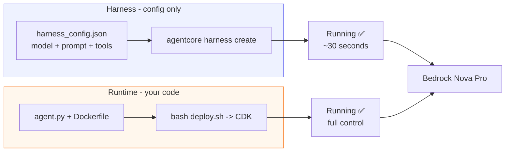
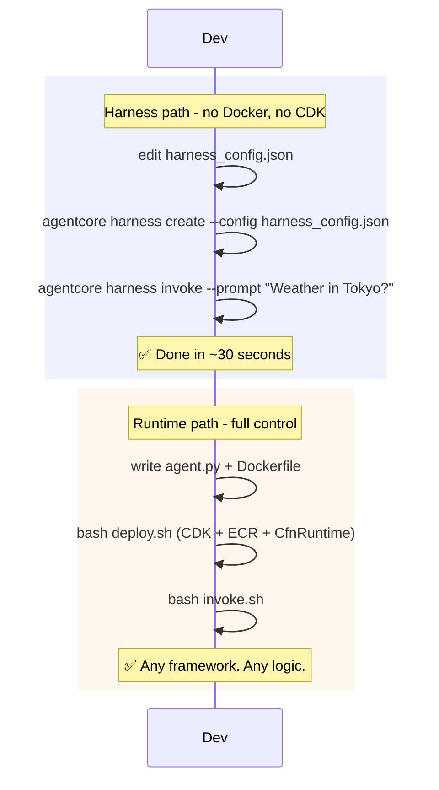
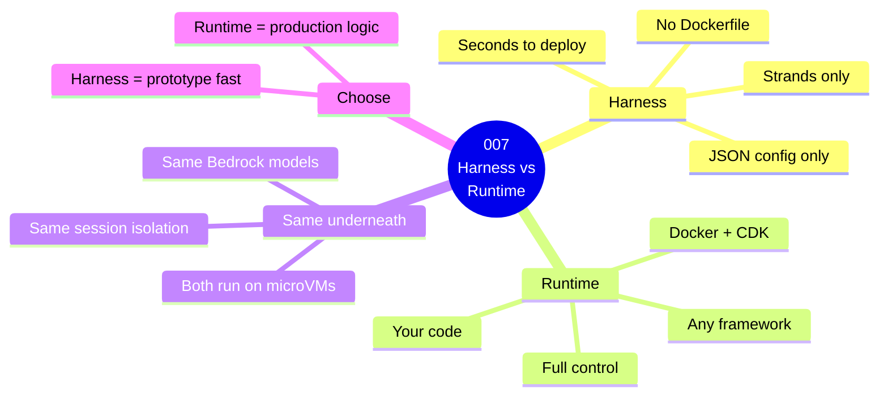

# 007 — Harness vs Runtime: Side-by-Side

## What

Build the **same travel assistant** twice — once using AgentCore Harness (pure config, no code deployment) and once using AgentCore Runtime (container + code). Compare the experience, control, and output.

## Why

AgentCore offers two ways to run agents in production:

| | Harness | Runtime |
|--|---------|---------|
| What you deploy | A JSON config | A Docker container |
| Code required | No | Yes |
| Custom frameworks | No (Strands only) | Yes (any framework) |
| Build time | Seconds | Minutes |
| Model switching | Config change | Code + redeploy |
| Custom business logic | Limited | Full control |
| When to use | Rapid prototyping, simple agents | Custom logic, any framework |
| Escape hatch | Export to code → Runtime | N/A |

Neither is better — they serve different needs. Most teams start with Harness, then graduate to Runtime when they need more control.

## Architecture

### Component Diagram



### Invocation Flow



### Guide Overview



---
## Steps

### Path A — Harness (Config Only)

```bash
cd 007-harness-vs-runtime

# 1. Create the harness
agentcore harness create \
  --config Source/harness_config.json \
  --region us-east-1

# 2. Invoke it
agentcore harness invoke \
  --name guide-007-harness \
  --prompt "What is the weather in Tokyo?" \
  --region us-east-1
```

### Path B — Runtime (Same Agent as Container)

```bash
# Deploy the Runtime version (same as guide 006)
bash deploy.sh

# Invoke
bash invoke.sh
```

### Compare

Both return similar answers. The difference is how they got there:
- Harness: you declared what the agent IS (model + prompt + tools)
- Runtime: you declared what the agent DOES (code + container)


## Cost Estimate

**Approximate cost: ~$0.05–$0.15/day**

Runtime: ~$0.0000267/session-sec; Harness: no extra charge (same Runtime pricing). Nova Pro: ~$0.001/call.

> For current pricing, see the [AgentCore pricing page](https://aws.amazon.com/bedrock/agentcore/pricing/) and [Bedrock pricing](https://aws.amazon.com/bedrock/pricing/). Always run `bash destroy.sh` after testing to stop billing.
## Cleanup

```bash
agentcore harness delete --name guide-007-harness --region us-east-1
bash destroy.sh
```

## Key Takeaways

- Harness = configuration; Runtime = code
- Both run on the same underlying infrastructure (microVMs)
- Harness is powered by Strands; Runtime is framework-agnostic
- Start with Harness, export to Runtime when you outgrow it
- `agentcore harness export --name <name>` gives you the Strands code

## Next Steps

- [`008-runtime-sessions`](../../008-runtime-sessions/) — Runtime session isolation deep dive
- [`046-harness-quickstart`](../../046-harness-quickstart/) — Harness deep dive
