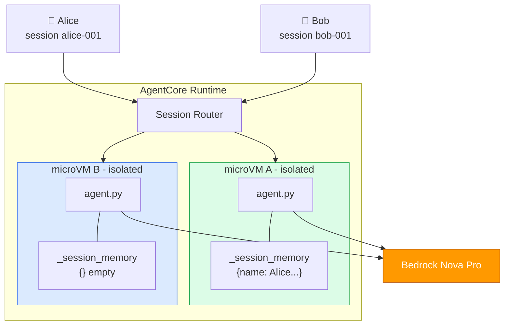
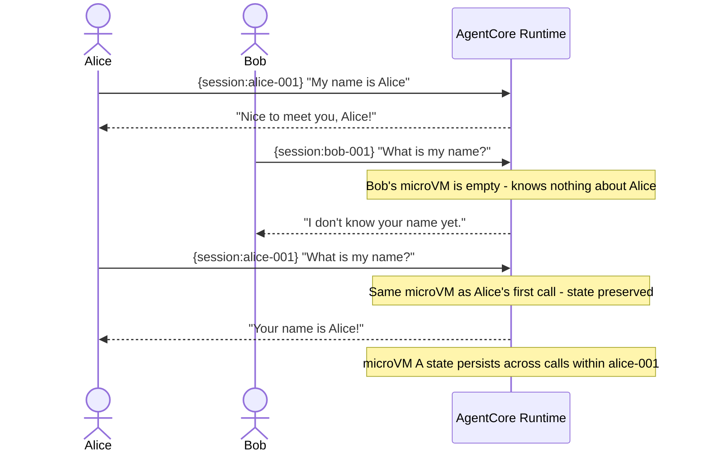
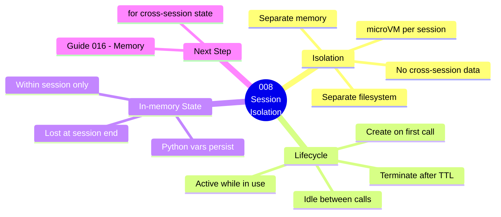

# 008 — Runtime Sessions & Isolation

## What

Prove that AgentCore Runtime gives each user session a completely isolated microVM with its own memory, by running two concurrent sessions and showing they can't see each other's data.

## Why

Session isolation is the most important property of AgentCore Runtime for production use. Here's what it means:

- **User Alice** starts a session → gets microVM A
- **User Bob** starts a session → gets microVM B
- Alice tells the agent her name → stored in microVM A
- Bob asks the agent "what's my name?" → microVM B has no idea
- Alice's session ends → microVM A is terminated and memory sanitized

This is what makes AgentCore Runtime suitable for real multi-user applications. Lambda doesn't have this — if concurrent users hit the same Lambda container, they can theoretically access each other's in-memory state.

## Architecture

### Component Diagram



### Invocation Flow



### Guide Overview



---
## Steps

### 1. Start the dev server

```bash
cd 008-runtime-sessions
pip3 install -r Source/requirements.txt
cd Source && agentcore dev
```

### 2. Test multi-turn context within a session

```bash
# Turn 1
agentcore invoke --dev '{"prompt": "My name is Alice and I prefer window seats."}'

# Turn 2 — same session, agent should remember
agentcore invoke --dev '{"prompt": "What seat preference did I mention?"}'
```

### 3. Run the full isolation test

```bash
pip3 install requests
python3 Source/test_sessions.py
```

This sends multiple turns to Session A and Session B in parallel and proves isolation.

### 4. Deploy to AWS

```bash
AWS_PROFILE=anvesh-aws-profile \
DOCKER_HOST=unix:///Users/anvesh.muppeda/.rd/docker.sock \
bash deploy.sh
```

### 5. Run the session isolation test (Alice vs Bob)

Proves that two different session IDs can never see each other's data even though they hit the same Runtime ARN.

```bash
AWS_PROFILE=anvesh-aws-profile bash invoke.sh
```

**What it does (5 calls):**

| Call | Session | Prompt | Expected result |
|------|---------|--------|----------------|
| 1 | alice-session | "My name is Alice and I love pizza" | Stores name + food |
| 2 | alice-session | "What is my name and food?" | Remembers Alice + pizza ✅ |
| 3 | bob-session | "What is my name and food?" | Empty — knows nothing about Alice ✅ |
| 4 | bob-session | "My name is Bob and I love burgers" | Stores name + food |
| 5 | bob-session | "Show me everything you know about me" | Only Bob + burgers, never Alice ✅ |

**Actual output from our test:**

```json
// Call 2 — Alice asks (same session)
{ "response": "Your name is Alice and you like pizza.",
  "session_memory_size": 2 }

// Call 3 — Bob asks (DIFFERENT session — never saw Alice's data)
{ "response": "It looks like I don't have your name or preferred food stored in this session.",
  "session_memory_size": 0 }

// Call 5 — Bob asks to see everything (same Bob session)
{ "response": "Your name is Bob. Your preferred food is burgers.",
  "session_memory_size": 2 }
```

Bob's `session_memory_size: 0` on Call 3 — while Alice's session had `session_memory_size: 2` — is the proof. Two different microVMs, zero shared state.

### 6. Run the idle timeout test (60s)

Proves that in-memory state is lost when the microVM is terminated after the idle timeout.

**Current configuration:** `idleRuntimeSessionTimeout = 60s` (set in `Infra/stacks/main_stack.py`)

```bash
AWS_PROFILE=anvesh-aws-profile bash invoke-timeout-test.sh
```

**What it does:**

```
Call 1  [12:25:44]  "My name is Anvesh"       → microVM starts, stores name
Call 2  [12:25:53]  "What is my name?" (+9s)  → SAME microVM → remembers ✅
        [wait 75s — 60s idle timeout fires — microVM terminated]
Call 3  [12:27:11]  "What is my name?" (+75s) → NEW microVM → FORGOTTEN ❌
```

**Actual output from our test:**

```json
// Call 1 — store name
{ "response": "I'll remember that user_name is 'Anvesh' for this session.",
  "session_memory_size": 1 }

// Call 2 — ask immediately (9 seconds later, same microVM)
{ "response": "Your name is Anvesh.",
  "session_memory_size": 1 }

// [75 seconds of silence — idle timeout fires — microVM terminated and memory sanitized]

// Call 3 — ask after timeout (same session ID, but NEW microVM)
{ "response": "Currently, there is nothing stored in the session memory.
               If you provide me with your name, I can remember it for future interactions.",
  "session_memory_size": 0 }
```

**Key observation:** Call 3 uses the **exact same session ID** as Calls 1 and 2 — yet `session_memory_size` is `0` and the agent has no idea who Anvesh is. This is AWS creating a brand new microVM behind the same session ID after the old one was terminated.


## Cost Estimate

**Approximate cost: ~$0.05–$0.10/day**

Runtime microVM: ~$0.0000267/session-sec. Sessions are billed while active — always stop sessions when testing is done.

> For current pricing, see the [AgentCore pricing page](https://aws.amazon.com/bedrock/agentcore/pricing/) and [Bedrock pricing](https://aws.amazon.com/bedrock/pricing/). Always run `bash destroy.sh` after testing to stop billing.
## Cleanup

```bash
bash destroy.sh
```

## How Session Memory Actually Works

This is the most important thing to understand about Guide 008. The memory is **not** coming from a database, AgentCore Memory, or any external store. It is a plain Python dictionary living inside the microVM process.

### Why it remembers between calls

When you send Call 1 and Call 2 seconds apart:

```
Call 1 (t=0s)   → AgentCore starts a microVM → agent.py runs → _session_memory = {name: "Alice"}
                   [request completes — microVM goes IDLE, does NOT terminate]
Call 2 (t=10s)  → AgentCore routes to THE SAME microVM → Python process still running
                   _session_memory still = {name: "Alice"} → agent answers correctly ✅
```

The microVM **stays alive** between calls. It sits idle, waiting for the next request on the same session. The Python process and all its variables remain intact.

### Session lifecycle — from AWS docs

| State | What it means |
|-------|--------------|
| **Active** | Currently processing a request |
| **Idle** | Request done — microVM still running, waiting for next call |
| **Stopped** | microVM terminated — memory sanitized, all data gone |

**Default timeouts (when `lifecycleConfiguration` is not set — which is what this guide uses):**

| Parameter | Default | Min | Max (microVM) | Max (Instances) |
|-----------|---------|-----|--------------|----------------|
| `idleRuntimeSessionTimeout` | **900s (15 min)** | 60s | 28800s (8 hr) | 1209600s (14 days) |
| `maxLifetime` | **28800s (8 hr)** | 60s | 28800s (8 hr) | 1209600s (14 days) |

**Constraint**: `idleRuntimeSessionTimeout` must always be ≤ `maxLifetime`.

Source: [AgentCore Runtime lifecycle settings](https://docs.aws.amazon.com/bedrock-agentcore/latest/devguide/runtime-lifecycle-settings.html)

### How to configure the timeouts

Timeouts are set via the `lifecycleConfiguration` parameter on `CreateAgentRuntime` / `UpdateAgentRuntime`.
In CDK (`CfnRuntime`), add the `lifecycle_configuration` property:

```python
# In your CDK stack (Infra/stacks/main_stack.py)
runtime = agentcore.CfnRuntime(
    self, "Runtime",
    agent_runtime_name=to_resource_name(GUIDE),
    agent_runtime_artifact=agentcore.CfnRuntime.AgentRuntimeArtifactProperty(
        container_configuration=agentcore.CfnRuntime.ContainerConfigurationProperty(
            container_uri=image.image_uri,
        ),
    ),
    role_arn=role.role_arn,
    network_configuration=agentcore.CfnRuntime.NetworkConfigurationProperty(
        network_mode="PUBLIC",
    ),
    # ── Lifecycle configuration ──────────────────────────────────────────
    lifecycle_configuration=agentcore.CfnRuntime.LifecycleConfigurationProperty(
        idle_runtime_session_timeout=1800,   # 30 minutes idle timeout
        max_lifetime=7200,                   # 2 hours max lifetime
    ),
)
```

Or via boto3 on an already-deployed runtime:

```python
import boto3

client = boto3.client('bedrock-agentcore-control', region_name='us-east-1')

# Update an existing runtime's lifecycle settings
client.update_agent_runtime(
    agentRuntimeId='g008_runtime_sessions-fKDlkAEBgX',
    agentRuntimeArtifact={
        'containerConfiguration': {
            'containerUri': '<your-ecr-image-uri>'
        }
    },
    networkConfiguration={'networkMode': 'PUBLIC'},
    roleArn='<your-role-arn>',
    lifecycleConfiguration={
        'idleRuntimeSessionTimeout': 300,   # 5 minutes — good for testing/demos
        'maxLifetime': 3600                 # 1 hour
    }
)
```

**What this guide currently uses:** `idleRuntimeSessionTimeout = 60s`, `maxLifetime = 3600s (1 hr)` — set in `main_stack.py` for the idle timeout demonstration. Change these values and redeploy to use different timeouts.

### Common timeout values to know

| Use case | idleRuntimeSessionTimeout | maxLifetime |
|----------|--------------------------|-------------|
| Testing / demos *(save cost)* | 60–300s (1–5 min) | 600s (10 min) |
| Interactive chat app | 1800s (30 min) | 14400s (4 hr) |
| **Default (this guide)** | **900s (15 min)** | **28800s (8 hr)** |
| Long-running workflows | 3600s (1 hr) | 28800s (8 hr) |
| Always-on (Instances only) | 86400s (1 day) | 1209600s (14 days) |

### What happens after the microVM stops

> *"After session termination, the entire microVM is terminated and memory is sanitized to remove all session data."*
> *"A subsequent request with the same runtimeSessionId after termination will create a new execution environment."*
> — [AWS Docs: runtime-how-it-works](https://docs.aws.amazon.com/bedrock-agentcore/latest/devguide/runtime-how-it-works.html)

This means:

```
session-alice, Call 1 (t=0)      → microVM A starts  → stores name="Alice"
session-alice, Call 2 (t=5min)   → same microVM A    → reads name="Alice"  ✅
                                    [idle for 15 minutes → microVM A terminated]
session-alice, Call 3 (t=20min)  → NEW microVM B     → name="Alice" is GONE ❌
session-alice, Call 4 (t=1year)  → NEW microVM C     → name="Alice" is GONE ❌
```

**If you use the same session ID one year later, the agent has no idea who you are.** The session ID is just a routing key. Once the microVM behind it is terminated, the next call with that ID simply creates a fresh microVM with empty state.

### Ephemeral by design — from AWS docs

> *"By default, the compute (microVM) associated with a session is ephemeral. Any data stored in memory or written to disk persists only for the compute lifecycle. This includes conversation history, user preferences, intermediate calculation results, and any other state information your agent maintains."*
> — [AWS Docs: Understanding ephemeral context](https://docs.aws.amazon.com/bedrock-agentcore/latest/devguide/runtime-sessions.html#ephemeral-context)

> *"Session state is ephemeral and should not be used for long-term durability — use AgentCore Memory for context durability."*
> — [AWS Docs: Sessions](https://docs.aws.amazon.com/bedrock-agentcore/latest/devguide/runtime-how-it-works.html#runtime-sessions-overview)

### Persistence options — what to use when

| Requirement | Solution | Guide |
|-------------|---------|-------|
| Remember within the same active microVM (seconds to hours) | Python variables — what this guide demonstrates | 008 (this guide) |
| Remember across microVM stop/resume cycles (filesystem data) | **Session Storage** — persistent EFS directory that survives compute termination | Future guide |
| Remember across sessions for the same user (hours to days) | **AgentCore Short-Term Memory** | 016 |
| Remember permanently, across all sessions, forever | **AgentCore Long-Term Memory** | Future guide |

---

## Key Takeaways

- Each session = one dedicated microVM — completely isolated CPU, memory, filesystem
- In-memory state (Python variables) persists **only while the microVM is alive**
- microVM stays idle between calls — it does NOT terminate after each request
- microVM terminates after idle timeout (configured to **60s in this guide**, default is 15 min)
- After microVM termination, same session ID → brand new microVM, **empty state**
- Sessions are completely isolated — no shared memory between different session IDs
- This guide uses **ephemeral in-memory state only** — not suitable for long-term persistence
- For durable memory across sessions, use **AgentCore Memory** (Guide 016+)

## Next Steps

- [`011-runtime-mcp-server`](../../011-runtime-mcp-server/) — Host an MCP server on Runtime
- [`016-memory-short-term`](../../016-memory-short-term/) — Persist context across sessions using AgentCore Memory
