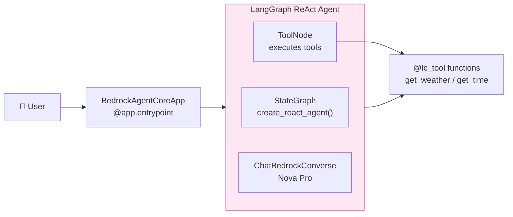
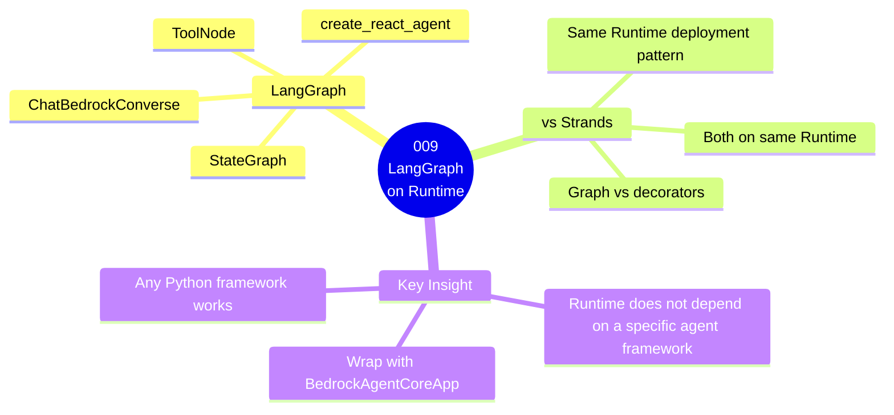

# 009 — LangGraph Agent on AgentCore Runtime

## What

Deploy a **LangGraph ReAct agent** to AgentCore Runtime and demonstrate how a
different agent framework can use the same general Runtime deployment pattern.

## Why

Every guide in the `01-runtime` series asks the same question:
**can I run my existing agent code on AgentCore Runtime without rewriting my infrastructure?**

Guide 009 answers: **yes — even LangGraph works.**

The CDK stack uses the same deployment pattern as Guide 006 (Strands), with
guide-specific names and configuration. You swap the framework inside the
container; Runtime does not depend on which framework runs in the image.

---

## What is LangGraph?

LangGraph is a framework for building agents as **explicit state machines (graphs)**.

| | Strands (Guide 006) | LangGraph (Guide 009) |
|--|--------------------|-----------------------|
| Approach | Declarative — give the LLM a list of tools, framework builds the loop | Graph-based — you define nodes, edges, and state explicitly |
| Setup | `Agent(tools=[...])` — one line | `create_react_agent()` builds a `StateGraph` |
| Control | Framework handles the ReAct loop | You own the graph structure |
| Good for | Quick agents, simple tool use | Complex workflows, conditional branching, multi-step pipelines |
| AgentCore Runtime | Supported | Supported — same deployment pattern |

`create_react_agent()` is a LangGraph helper that builds this state machine automatically:

```
START
  ↓
[agent node]  ← LLM (Nova Pro) decides: answer directly OR call a tool
  ↓  ↑
[tools node]  ← if LLM called a tool, execute it, return result to agent node
  ↓
END           ← when LLM stops calling tools and gives a final answer
```

---

## Architecture

### Component Diagram



### Invocation Flow

```mermaid
sequenceDiagram
    actor User
    participant A  as BedrockAgentCoreApp
    participant LG as LangGraph StateGraph
    participant B  as Bedrock Nova Pro

    User  ->> A  : invoke({"prompt":"Weather in Tokyo?"})
    A     ->> LG : graph.invoke({"messages":[HumanMessage]})
    loop LangGraph ReAct loop
        LG    ->> B  : ChatBedrockConverse.invoke()
        B    -->> LG : AIMessage(tool_calls=[get_weather("Tokyo")])
        LG    ->> LG : ToolNode.execute(get_weather)
        LG    ->> B  : invoke(messages + ToolMessage("79F, Clear"))
        B    -->> LG : AIMessage("The weather in Tokyo is clear...")
    end
    LG   -->> A  : final AIMessage
    A    -->> User : {"response":"The weather in Tokyo is clear..."}
    note over A,LG: Same CDK deployment pattern as Guide 007; guide-specific identifiers differ
```

### Guide Overview



---

## How the Code Works

### Step 1 — Define tools with LangChain's @lc_tool

LangGraph uses LangChain-style tools (not Strands `@tool`). The decorator generates
the JSON schema that the LLM uses to decide when and how to call each tool.

```python
from langchain_core.tools import tool as lc_tool

@lc_tool
def get_weather(location: str) -> str:
    """Get the current weather for a city or location."""
    # Returns mock data: Tokyo → "Clear, 79°F / 26°C, humidity 55%"

@lc_tool
def get_time(location: str) -> str:
    """Get the current local time for a city or timezone name."""
    # Uses real Python zoneinfo for accurate timezone conversion
```

### Step 2 — Build the LangGraph agent (at module load time)

```python
from langchain_aws import ChatBedrockConverse
from langgraph.prebuilt import create_react_agent

_llm = ChatBedrockConverse(
    model="us.amazon.nova-pro-v1:0",
    region_name="us-east-1",
)

_graph = create_react_agent(
    model=_llm,
    tools=[get_weather, get_time],
    prompt="You are a helpful travel assistant. Use get_weather and get_time to answer questions.",
)
```

`_graph` is a compiled `StateGraph`. It is created once when the Python process starts
and remains in memory for that process lifetime. This example does not configure a
LangGraph checkpointer or retain message history: each invocation passes only the
current prompt, so the agent does not remember earlier turns automatically.

### Step 3 — Wrap with BedrockAgentCoreApp

```python
from bedrock_agentcore import BedrockAgentCoreApp
from langchain_core.messages import HumanMessage

app = BedrockAgentCoreApp()

@app.entrypoint
def invoke(payload: dict) -> dict:
    prompt = payload.get("prompt", "").strip()

    # Invoke the LangGraph graph with the user message
    result = _graph.invoke({"messages": [HumanMessage(content=prompt)]})

    # The last message in the state is the final LLM response
    final_answer = result["messages"][-1].content
    return {"response": final_answer}
```

`BedrockAgentCoreApp` is identical to every other guide — it handles the HTTP server,
health checks, and AgentCore Runtime protocol. The framework inside does not matter.

---

## Guide 009 vs Guide 006 — framework comparison

The agent implementation changes from Strands to LangGraph. Both guides use the
same general shared-role and Runtime deployment pattern, with guide-specific stack
names and configuration:

```diff
  # Framework imports
- from strands import Agent, tool
- from strands.models import BedrockModel
+ from langchain_aws import ChatBedrockConverse
+ from langchain_core.tools import tool as lc_tool
+ from langgraph.prebuilt import create_react_agent

  # Tool decorator
- @tool
+ @lc_tool
  def get_weather(location: str) -> str: ...

  # Agent / graph construction
- agent = Agent(
-     model=BedrockModel(model_id="us.amazon.nova-pro-v1:0"),
-     tools=[get_weather, get_time],
-     system_prompt="You are a helpful travel assistant..."
- )
+ _graph = create_react_agent(
+     model=ChatBedrockConverse(model="us.amazon.nova-pro-v1:0"),
+     tools=[get_weather, get_time],
+     prompt="You are a helpful travel assistant..."
+ )

  # Entrypoint — how to call the agent
- response = agent(prompt)
- return {"response": str(response)}
+ result = _graph.invoke({"messages": [HumanMessage(content=prompt)]})
+ return {"response": result["messages"][-1].content}
```

No new infrastructure pattern is required; the CDK stack uses the same shared-role
and Runtime constructs as Guide 007, with guide-specific identifiers.

---

## Steps

Before deploying, deploy [`000-common-infra`](../../00-foundations/000-common-infra/) once if it is not already deployed.

### 1. Deploy

```bash
bash deploy.sh
```

### 2. Invoke

```bash
bash invoke.sh
```

### 3. View logs

```bash
aws logs tail /aws/agents-on-aws/009-runtime-langgraph \
  --follow \
  --region us-east-1
```

---

## Actual Test Output

Tested on: AgentCore Runtime, us-east-1, Nova Pro v1

```bash
$ bash invoke.sh
```

```
Stack:   Guide009RuntimeLanggraph
Session: 44bb07ad-cfa1-4fa9-98d3-7d4be0d757b2
Prompt:  What is the weather in Tokyo?

Runtime: <Runtime ARN from your deployment>

{
  "response": "The weather in Tokyo is currently clear with a temperature of 79°F (26°C) and humidity at 55%."
}
```

**What happened inside LangGraph during this call:**

```
1. BedrockAgentCoreApp received: {"prompt": "What is the weather in Tokyo?"}

2. graph.invoke() started with:
   messages = [HumanMessage("What is the weather in Tokyo?")]

3. agent node — Nova Pro decided:
   → Call get_weather(location="Tokyo")
   → AIMessage(tool_calls=[{"name": "get_weather", "args": {"location": "Tokyo"}}])

4. tools node — executed get_weather("Tokyo"):
   → ToolMessage("Weather in Tokyo: Clear, 79°F / 26°C, humidity 55%")

5. agent node — Nova Pro saw the tool result:
   → No more tools needed
   → AIMessage("The weather in Tokyo is currently clear with a temperature of 79°F (26°C) and humidity at 55%.")

6. graph returned final state
   → messages[-1].content = the response above
```

---

## Bug Fixed During Development

The code was written for an older LangGraph API. The `state_modifier` parameter was
renamed to `prompt` in LangGraph v1.x.

```diff
  _graph = create_react_agent(
      model=_llm,
      tools=[get_weather, get_time],
-     state_modifier="You are a helpful travel assistant..."  # old API — crashes on import
+     prompt="You are a helpful travel assistant..."          # v1.x API — correct
  )
```

**Symptom:** `RuntimeClientError: An error occurred when starting the runtime` with no
CloudWatch logs — the container crashed at Python import time before BedrockAgentCoreApp
could even start.

**Diagnosis:** Run `python3 -c "import app.agent"` locally inside `Source/` to catch
import-time crashes instantly without deploying to AWS.

---

## Cost Estimate

| Resource | Details | Cost |
|----------|---------|------|
| Runtime microVM | ~$0.0000267/session-second | ~$0.05–$0.15/day |
| Nova Pro | ~$0.001/inference call | negligible |
| ECR | $0.10/GB/month | ~$0.01/month |

> Always run `bash destroy.sh` after testing. See [AgentCore pricing](https://aws.amazon.com/bedrock/agentcore/pricing/).

---

## Cleanup

```bash
bash destroy.sh
```

---

## Key Takeaways

- **Runtime hosting is framework-independent.** The released examples demonstrate Strands and LangGraph; their CDK stacks share a pattern but retain guide-specific configuration.
- **LangGraph builds an explicit state machine** — you own the graph; `create_react_agent()` is just a helper that wires a standard ReAct loop
- **`_graph` is created once per Python process** — but this example does not persist conversation history between invocations
- **`BedrockAgentCoreApp` is always the outermost wrapper** — regardless of framework
- **Import-time crashes show as `RuntimeClientError` with no CW logs** — always test with `python3 -c "import app.agent"` locally first

## Next Steps

- [`010-runtime-any-model`](../010-runtime-any-model/) — swap Bedrock for any model provider
- [`011-runtime-mcp-server`](../011-runtime-mcp-server/) — host an MCP server on Runtime instead of an agent
- [`012-runtime-a2a`](../012-runtime-a2a/) — discover and delegate tasks to an A2A specialist on Runtime
