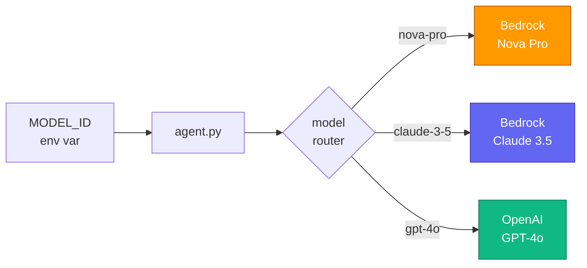
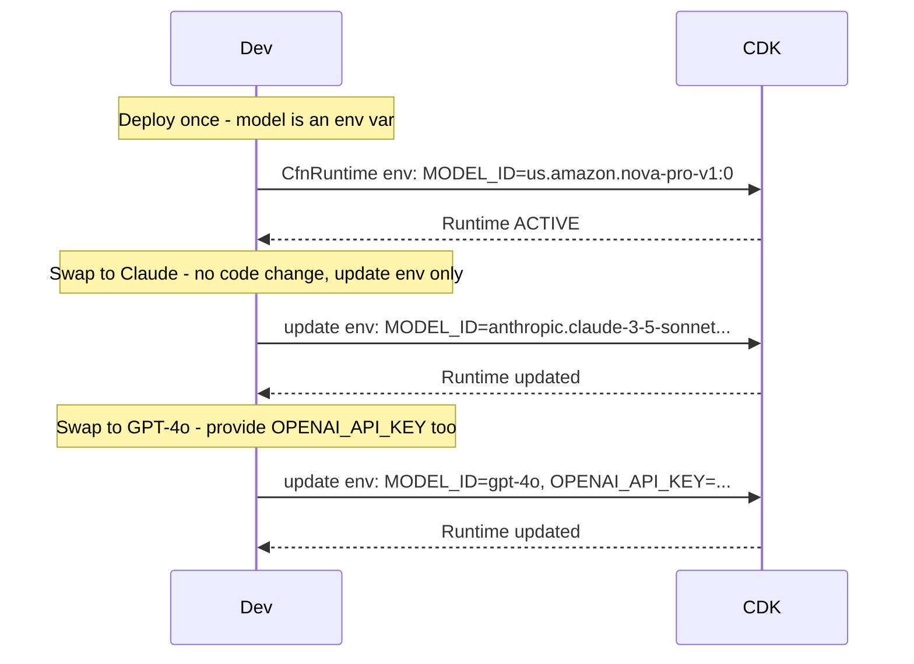
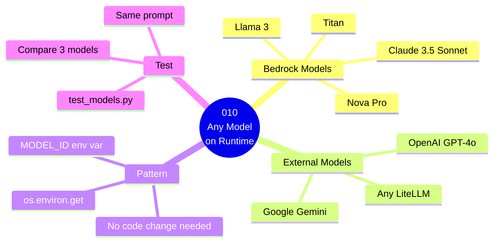

# 010 — AgentCore Runtime: Model-Agnostic Agents

## What

This guide proves that **AgentCore Runtime is completely model-agnostic**. The same
agent container — same code, same Docker image, same deployment — runs identically
on Claude, Amazon Nova, and Titan by swapping a **single environment variable**.

No Docker rebuild. No ECR push. No code change. Just update `MODEL_ID`.

## Why

Teams often lock themselves into one foundation model early. AgentCore Runtime lets
you swap models without rebuilding or redeploying. You can:

- A/B test models in production by routing traffic to different `MODEL_ID` configs
- Roll back to a previous model instantly — update env var, no container rebuild
- Run the same agent against multiple models for evaluation or cost comparison

---

## The Core Pattern — One Line

This is the entire point of the guide:

```python
# agent.py
MODEL_ID = os.environ.get("MODEL_ID", "us.amazon.nova-pro-v1:0")

_model = BedrockModel(model_id=MODEL_ID, region_name=REGION)
```

`MODEL_ID` is read from the environment at startup. The CDK stack sets it as an
environment variable on the Runtime. Change the env var → Runtime restarts with
the new model. Same container, same IAM role, same CDK stack.

---

## The Progression Across Guides 006–010

Every guide in `01-runtime` proves one thing: **the Runtime infrastructure never changes,
only what's inside the container changes.**

| Guide | What changes | What stays the same |
|-------|-------------|---------------------|
| 006 | First Runtime deploy | CDK pattern established |
| 007 | Strands framework | Same CDK |
| 008 | Session isolation | Same CDK |
| 009 | LangGraph framework | Same CDK |
| **010** | **Model = env var, hot-swap without rebuild** | Same CDK, same Strands |

## Architecture

### Component Diagram



### Invocation Flow



### Guide Overview



---
## Model Comparison Table

These are the three models used in `test_models.py` — all active in us-east-1 as of November 2026:

| Feature                | Nova Pro                  | Nova Lite                 | Nova Micro                |
|------------------------|---------------------------|---------------------------|---------------------------|
| Model ID               | `us.amazon.nova-pro-v1:0` | `us.amazon.nova-lite-v1:0`| `us.amazon.nova-micro-v1:0`|
| Context Window         | 300K tokens               | 300K tokens               | 128K tokens               |
| Tool Use               | ✅ Native                 | ✅ Native                 | ✅ Native                 |
| Streaming              | ✅                        | ✅                        | ✅                        |
| Cross-region (`us.`)   | ✅                        | ✅                        | ✅                        |
| Best For               | Complex reasoning, agents | Balanced speed/cost       | Fastest, cheapest         |
| Approx cost (output)   | $0.0024/1K tokens         | $0.00024/1K tokens        | $0.000035/1K tokens       |

## Actual Test Output

Tested on: AgentCore Runtime, us-east-1, `MODEL_ID=us.amazon.nova-pro-v1:0`

```bash
$ bash invoke.sh
```

```json
{
  "response": "The agent loop involves interpreting the user's request, determining
               the appropriate tool to use, executing the tool, and then providing
               the user with the results or further assistance based on the tool's output.",
  "model_id": "us.amazon.nova-pro-v1:0",
  "region":   "us-east-1"
}
```

**Why `model_id` and `region` are in the response:**
The agent explicitly returns which model answered. When A/B testing two runtimes with
different `MODEL_ID` values, you can confirm which model handled each request just
by looking at the response.

---

## How to Switch Models (Zero Redeployment)

In `Infra/stacks/main_stack.py`, change the env var and run `deploy.sh`:

```python
environment_variables={
    # From Nova Pro → Claude 3.5 Sonnet — no container rebuild, no ECR push
    "MODEL_ID": "us.anthropic.claude-3-5-sonnet-20241022-v2:0",
}
```

CDK detects only the env var changed. Runtime restarts with the new model in ~30s.

---

## Steps

### 1. Install dependencies

```bash
pip3 install -r Source/requirements.txt
```

### 2. Test locally with default model (Nova Pro)

```bash
bash dev.sh
# in another terminal:
bash invoke-dev.sh
```

### 3. Test locally with different models

```bash
# Override MODEL_ID for the local dev server
MODEL_ID=us.anthropic.claude-3-5-sonnet-20241022-v2:0 bash dev.sh
```

### 4. Run the multi-model comparison script

```bash
cd Source
AWS_PROFILE=anvesh-aws-profile python3 test_models.py
```

This starts three local servers simultaneously (ports 8081, 8082, 8083),
sends the same two prompts to each, and prints a side-by-side comparison.

**Actual output from our test (us-east-1, November 2026):**

```
Prompt: "What is the weather in London right now?"

  [Amazon Nova Pro]   (latency: 1.59s)
  "The current weather in London is 61°F (16°C) with light rain,
   82% humidity, and a 10 mph wind from the southwest."

  [Amazon Nova Lite]  (latency: 1.65s)
  "The current weather in London is: Temperature: 61°F / 16°C,
   Condition: Light Rain, Humidity: 82%, Wind: 10 mph SW"

  [Amazon Nova Micro] (latency: 1.14s)
  "The current weather in London is: Temperature: 61°F / 16°C,
   Condition: Light Rain, Humidity: 82%, Wind: 10 mph SW.
   I'm here to help with any other weather queries!"


LATENCY SUMMARY (seconds)
  Model                    Prompt 1    Prompt 2
  Amazon Nova Pro            1.59s       2.17s
  Amazon Nova Lite           1.65s       1.98s
  Amazon Nova Micro          1.14s       1.38s
```

**What the comparison reveals:**
- **Nova Micro is fastest** (1.1–1.4s) and cheapest ($0.000035/1K output tokens)
- **All three give correct answers** — same tool call, same data, different phrasing
- **Nova Pro writes slightly more naturally** ("with light rain" vs bullet list)
- **Cost difference is ~70x** between Pro and Micro for the same answer quality

This is exactly the kind of evaluation you run before deciding which model to deploy
in production for a given use case.

### 5. Deploy to AgentCore Runtime

```bash
bash deploy.sh
```

CDK builds the container, pushes to ECR, outputs the image URI and role ARN.
The Makefile then calls `agentcore runtime create` to create the runtime agent.

### 6. Invoke in the cloud

```bash
bash invoke.sh
```

### 7. Try different models in the cloud (zero redeployment)

```bash
# Update the runtime env var and re-invoke — no container rebuild needed
agentcore runtime update \
  --name guide-003-any-model \
  --env MODEL_ID=us.anthropic.claude-3-5-sonnet-20241022-v2:0 \
  --region us-east-1

bash invoke.sh
```


## Cost Estimate

**Approximate cost: ~$0.05–$0.30/day (varies by model)**

Nova Pro: ~$0.0008/1K in / $0.0024/1K out. Claude 3.5 Sonnet: ~$0.003/1K in / $0.015/1K out. Runtime infrastructure: ~$0.0000267/session-sec.

> For current pricing, see the [AgentCore pricing page](https://aws.amazon.com/bedrock/agentcore/pricing/) and [Bedrock pricing](https://aws.amazon.com/bedrock/pricing/). Always run `bash destroy.sh` after testing to stop billing.
## Cleanup

```bash
bash destroy.sh
```

This deletes the AgentCore Runtime agent and the CDK stack (ECR repo + IAM role).

## Key Takeaways

1. **One image, many models** — `MODEL_ID` is the only change needed to switch models.
2. **BedrockModel auto-configures** — Strands `BedrockModel` accepts any Bedrock model ID.
3. **Zero-downtime model switch** — updating an env var takes ~30 seconds with no code change.
4. **Cross-region inference profiles** — prefix `us.` enables automatic failover across regions.
5. **Evaluate before committing** — use `test_models.py` to compare responses before updating prod.

## Next Steps

- **011** — Expose your agent as an MCP server using AgentCore Runtime
- **013** — Add streaming responses for real-time output
- **014** — Handle long-running tasks with async invocation
