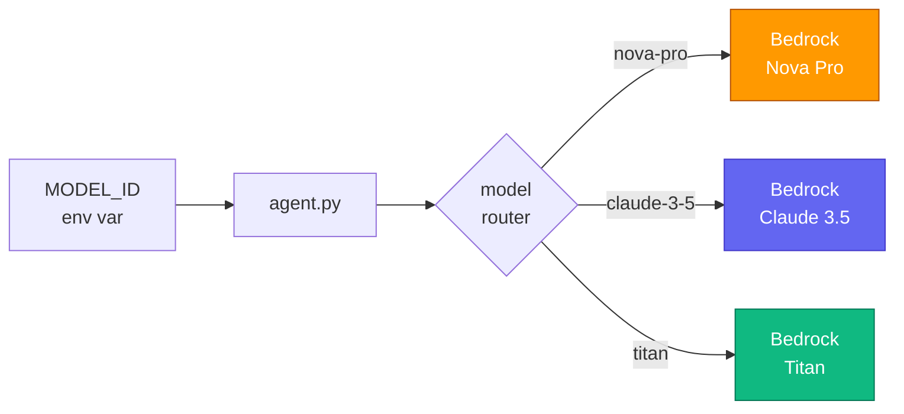
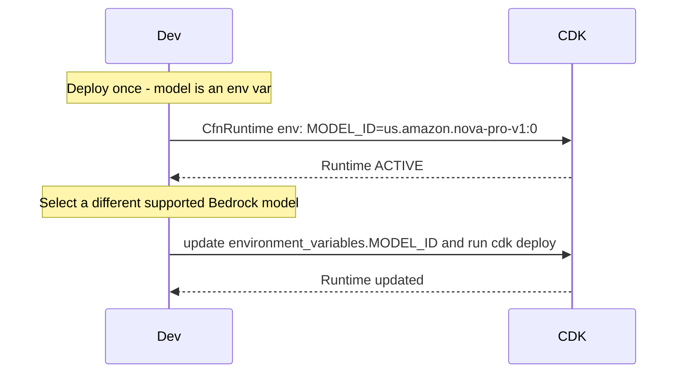
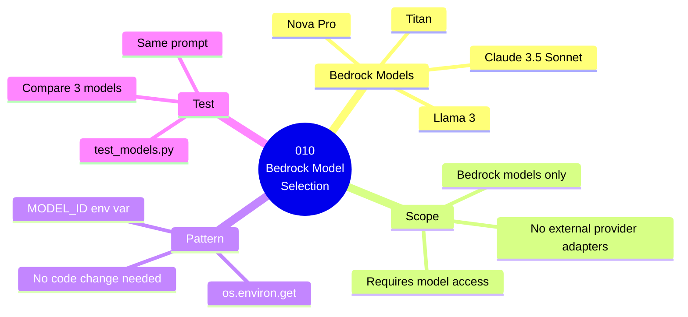

# 010 — AgentCore Runtime: Bedrock Model Selection

## What

This guide shows how to select among **Amazon Bedrock models supported by Strands**
using the `MODEL_ID` environment variable. The agent reads the model ID at startup;
the deployed Runtime's environment is configured in the CDK stack.

## Why

Teams may want to compare model quality, latency, and cost before choosing a model.
This guide uses the same agent code with different Bedrock model IDs. Local testing
can override `MODEL_ID` without editing the source; changing the deployed model
requires updating the CDK configuration and deploying the stack. This guide does not
implement OpenAI, Google, or other non-Bedrock providers.

For parallel production A/B testing, deploy separately configured Runtime stacks
and route requests between them; changing one Runtime's environment is not A/B routing.

---

## The Core Pattern — One Line

This is the entire point of the guide:

```python
# agent.py
MODEL_ID = os.environ.get("MODEL_ID", "us.amazon.nova-pro-v1:0")

_model = BedrockModel(model_id=MODEL_ID, region_name=REGION)
```

`MODEL_ID` is read from the environment at startup. The CDK stack sets it as an
environment variable on the Runtime. Locally, set the variable before starting the
dev server. In AWS, update the value in the CDK stack and run `bash deploy.sh`;
this updates the Runtime configuration. If the source image is unchanged, CDK can
reuse its existing asset, but the Runtime still receives a deployment update.

---

## The Progression Across Guides 006–010

The `01-runtime` guides reuse a common Runtime deployment pattern while changing
the agent code, protocol, or configuration to demonstrate different features.

| Guide | What changes | What stays the same |
|-------|-------------|---------------------|
| 006 | First Runtime deploy | CDK pattern established |
| 007 | Strands framework | Same CDK |
| 008 | Session isolation | Same Runtime hosting pattern |
| 009 | LangGraph framework | Same Runtime hosting pattern |
| **010** | **Select a Bedrock model through an environment variable** | Same agent implementation; model ID is configuration |

## Architecture

### Component Diagram



### Invocation Flow



### Guide Overview



---
## Model Comparison Table

These are the three models used in `test_models.py` — all active in us-east-1 as of November 2026:

| Feature                | Nova Pro                  | Nova Lite                 | Nova Micro                |
|------------------------|---------------------------|---------------------------|---------------------------|
| Model ID               | `us.amazon.nova-pro-v1:0` | `us.amazon.nova-lite-v1:0`| `us.amazon.nova-micro-v1:0`|
| Context Window         | 300K tokens               | 300K tokens               | 128K tokens               |
| Tool Use               | ✅ Native                 | ✅ Native                 | ✅ Native                 |
| Streaming              | ✅                        | ✅                        | ✅                        |
| Inference profile      | US profile available      | US profile available      | US profile available      |
| Best For               | Complex reasoning, agents | Balanced speed/cost       | Fastest, cheapest         |
| Approx cost (output)   | $0.0024/1K tokens         | $0.00024/1K tokens        | $0.000035/1K tokens       |

## Actual Test Output

Tested on: AgentCore Runtime, us-east-1, `MODEL_ID=us.amazon.nova-pro-v1:0`

```bash
$ bash invoke.sh
```

```json
{
  "response": "The agent loop involves interpreting the user's request, determining
               the appropriate tool to use, executing the tool, and then providing
               the user with the results or further assistance based on the tool's output.",
  "model_id": "us.amazon.nova-pro-v1:0",
  "region":   "us-east-1"
}
```

**Why `model_id` and `region` are in the response:**
The agent explicitly returns which model answered. When A/B testing two runtimes with
different `MODEL_ID` values, you can confirm which model handled each request just
by looking at the response.

---

## How to Change the Deployed Model

In `Infra/stacks/main_stack.py`, change the environment variable and deploy the
updated CDK stack:

```python
environment_variables={
    # Example: select a different Bedrock model available to your account
    "MODEL_ID": "us.anthropic.claude-3-5-sonnet-20241022-v2:0",
}
```

Run `bash deploy.sh` to apply the change. The Runtime configuration is updated;
the container image does not need source changes for a model selection change.
Confirm the selected model is enabled and available in your account and region.

---

## Prerequisites

- Complete [`001-prerequisites`](../../00-foundations/001-prerequisites/README.md)
- Deploy [`000-common-infra`](../../00-foundations/000-common-infra/) once before deploying this guide
- Enable access to the Bedrock models you plan to use in your AWS account and region

## Steps

### 1. Install dependencies

```bash
pip3 install -r Source/requirements.txt
```

### 2. Test locally with default model (Nova Pro)

```bash
bash dev.sh
# in another terminal:
bash invoke-dev.sh
```

### 3. Test locally with different models

```bash
# Override MODEL_ID for the local dev server
MODEL_ID=us.anthropic.claude-3-5-sonnet-20241022-v2:0 bash dev.sh
```

### 4. Run the multi-model comparison script

```bash
cd Source
python3 test_models.py
```

The script uses the AWS credential chain. Set `AWS_PROFILE=your-profile` first if
you need a named profile.

This starts three local servers simultaneously (ports 8081, 8082, 8083),
sends the same two prompts to each, and prints a side-by-side comparison.

**Actual output from our test (us-east-1, November 2026):**

```
Prompt: "What is the weather in London right now?"

  [Amazon Nova Pro]   (latency: 1.59s)
  "The current weather in London is 61°F (16°C) with light rain,
   82% humidity, and a 10 mph wind from the southwest."

  [Amazon Nova Lite]  (latency: 1.65s)
  "The current weather in London is: Temperature: 61°F / 16°C,
   Condition: Light Rain, Humidity: 82%, Wind: 10 mph SW"

  [Amazon Nova Micro] (latency: 1.14s)
  "The current weather in London is: Temperature: 61°F / 16°C,
   Condition: Light Rain, Humidity: 82%, Wind: 10 mph SW.
   I'm here to help with any other weather queries!"


LATENCY SUMMARY (seconds)
  Model                    Prompt 1    Prompt 2
  Amazon Nova Pro            1.59s       2.17s
  Amazon Nova Lite           1.65s       1.98s
  Amazon Nova Micro          1.14s       1.38s
```

**What the comparison reveals:**
- **Nova Micro is fastest** (1.1–1.4s) and cheapest ($0.000035/1K output tokens)
- **All three give correct answers** — same tool call, same data, different phrasing
- **Nova Pro writes slightly more naturally** ("with light rain" vs bullet list)
- **Cost difference is ~70x** between Pro and Micro for the same answer quality

This is exactly the kind of evaluation you run before deciding which model to deploy
in production for a given use case.

### 5. Deploy to AgentCore Runtime

```bash
bash deploy.sh
```

CDK builds or reuses the container image asset, pushes it to ECR if needed, and
creates or updates the Runtime and its configuration.

### 6. Invoke in the cloud

```bash
bash invoke.sh
```

### 7. Try a different model in the cloud

```bash
# Update MODEL_ID in Infra/stacks/main_stack.py, then deploy the stack
bash deploy.sh

bash invoke.sh
```


## Cost Estimate

**Approximate cost: ~$0.05–$0.30/day (varies by model)**

Nova Pro: ~$0.0008/1K in / $0.0024/1K out. Claude 3.5 Sonnet: ~$0.003/1K in / $0.015/1K out. Runtime infrastructure: ~$0.0000267/session-sec.

> For current pricing, see the [AgentCore pricing page](https://aws.amazon.com/bedrock/agentcore/pricing/) and [Bedrock pricing](https://aws.amazon.com/bedrock/pricing/). Always run `bash destroy.sh` after testing to stop billing.
## Cleanup

```bash
bash destroy.sh
```

This deletes the AgentCore Runtime and this guide's CloudWatch log group. The shared IAM role is managed by Guide 000. The Docker image asset is stored in the shared CDK bootstrap ECR repository and may remain after this stack is destroyed.

## Key Takeaways

1. **One agent, multiple Bedrock model options** — select a compatible model with `MODEL_ID`.
2. **BedrockModel auto-configures** — Strands `BedrockModel` accepts compatible Bedrock model IDs.
3. **Model selection is configuration** — update the CDK environment and deploy; no agent source change is needed.
4. **Inference profiles** — supported `us.` model IDs route requests through a Bedrock US inference profile where available.
5. **Evaluate before committing** — use `test_models.py` to compare responses before updating prod.

## Next Steps

- **011** — Expose your agent as an MCP server using AgentCore Runtime
- **013** — Add streaming responses for real-time output
- **014** — Handle long-running tasks with async invocation
