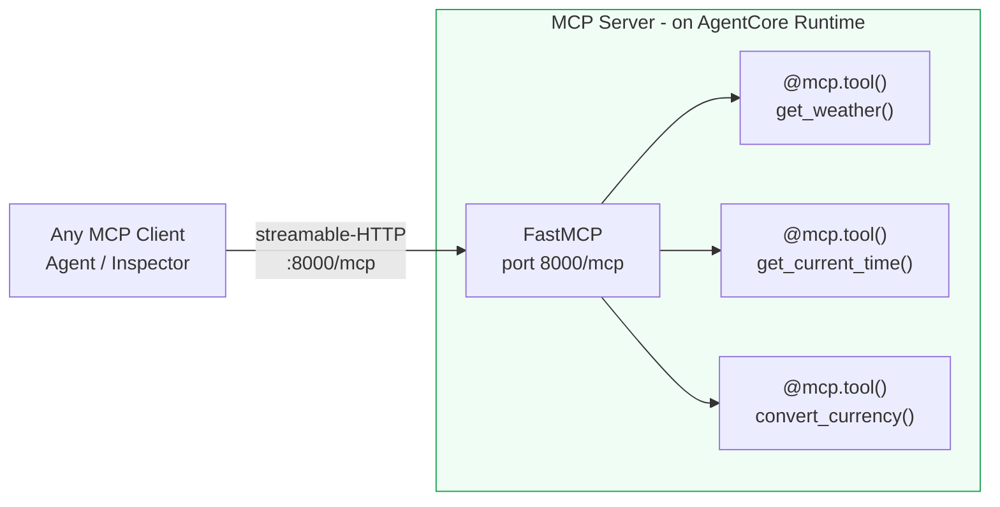
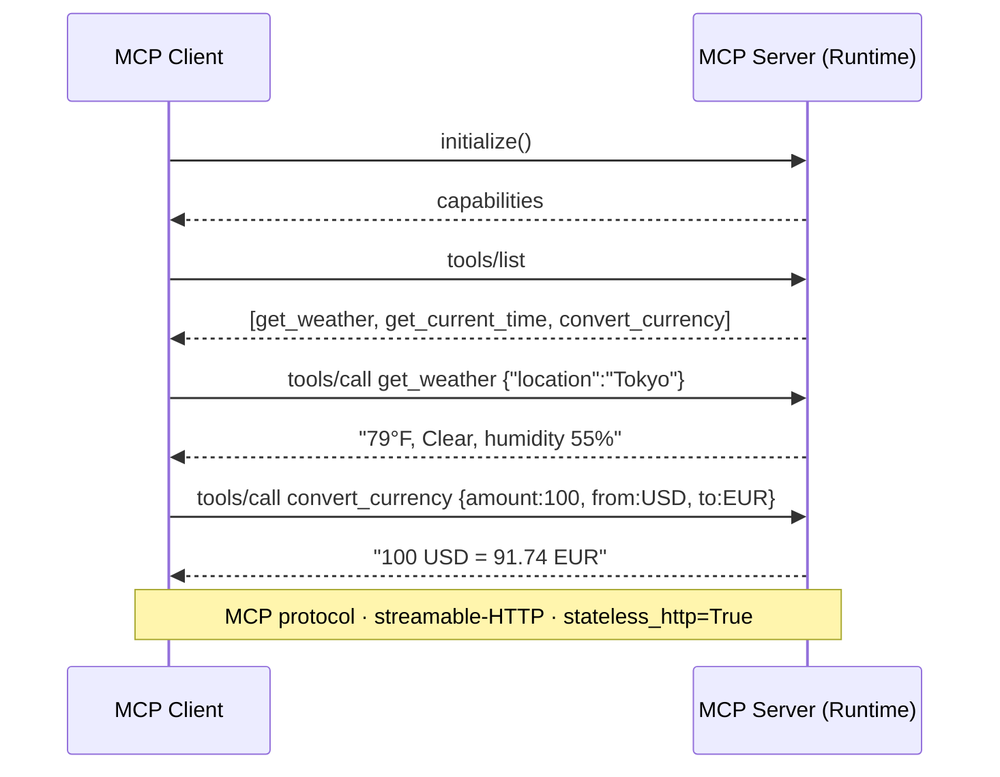
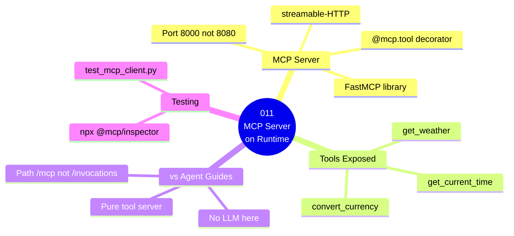

# 011 — MCP Server on AgentCore Runtime

## What

Deploy a **Model Context Protocol (MCP) server** to AgentCore Runtime. The server exposes Python tool functions that any agent can discover and call, without embedding the tools directly in the agent.

## Why

MCP (Model Context Protocol) is the open standard for connecting agents to tools. Instead of every agent carrying its own tools, you deploy tool servers that **any agent can connect to**. This is composability:

```
Agent A ─────────►  Travel Tools MCP Server  ◄─────── Agent B
                    (on AgentCore Runtime)
                    ├── get_weather()
                    ├── get_current_time()
                    └── convert_currency()
```

Benefits:
- One tool server, many consumers — no duplication
- Tools scale independently from agents
- Change tool logic without touching agents
- Runtime gives MCP servers the same isolation and auth as agents

## Architecture

### Component Diagram



### Invocation Flow



### Guide Overview



---
## Key Differences from Agent Guides

| Previous guides | This guide |
|---|---|
| Runtime hosts an agent | Runtime hosts a TOOL SERVER |
| Container runs on port 8080 | Container runs on port 8000 |
| Path: `/invocations` | Path: `/mcp` |
| Calls Bedrock | No LLM — pure functions |

## Steps

### 1. Test locally

```bash
cd 011-runtime-mcp-server
pip3 install -r Source/requirements.txt

# Terminal 1: start the MCP server
python3 Source/app/agent.py

# Terminal 2: test with the MCP client
python3 Source/test_mcp_client.py
```

### 2. Test with MCP Inspector

```bash
npx @modelcontextprotocol/inspector http://localhost:8000/mcp
```

### 3. Deploy to AgentCore Runtime

```bash
bash deploy.sh
```

This deploys the MCP server as a Runtime agent with the `MCP` protocol.

### 4. Connect from another agent

See `Source/consumer_agent.py` for how a Strands agent connects to the deployed MCP server.


## Cost Estimate

**Approximate cost: ~$0.05–$0.10/day**

Runtime (MCP server): ~$0.0000267/session-sec. Each connected client starts a session.

> For current pricing, see the [AgentCore pricing page](https://aws.amazon.com/bedrock/agentcore/pricing/) and [Bedrock pricing](https://aws.amazon.com/bedrock/pricing/). Always run `bash destroy.sh` after testing to stop billing.
## Cleanup

```bash
bash destroy.sh
```

## Key Takeaways

- AgentCore Runtime hosts MCP servers, not just agents
- MCP servers use port 8000 and path `/mcp` (not 8080/invocations)
- `FastMCP` + `@mcp.tool()` is the server-side pattern
- `MCPClient` + `list_tools_sync()` is the consumer pattern
- MCP enables tool reuse across multiple agents

## Next Steps

- [`012-runtime-a2a`](../../012-runtime-a2a/) — Agent-to-Agent protocol
- [`021-gateway-lambda-tool`](../../021-gateway-lambda-tool/) — Expose tools via AgentCore Gateway
