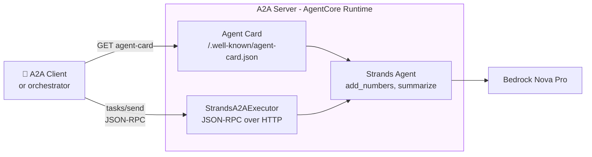
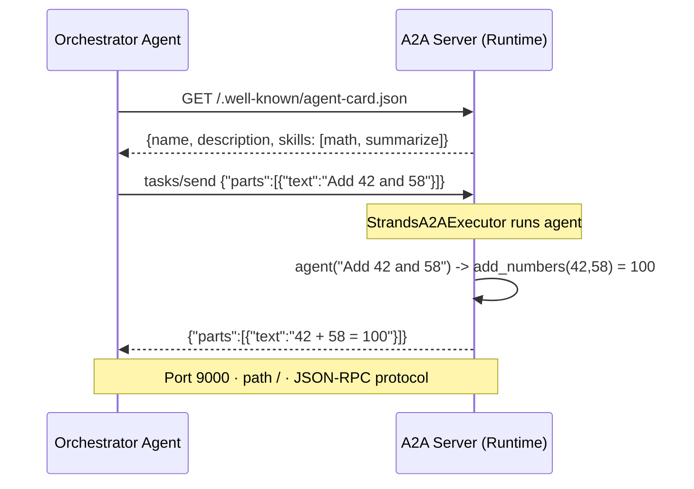
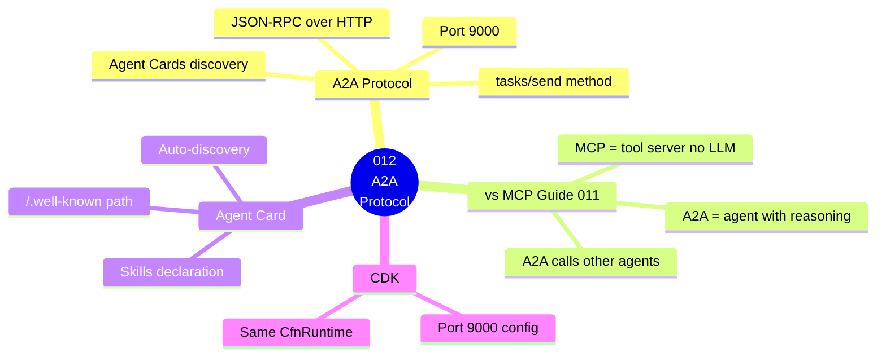

# 012 — AgentCore Runtime: Agent-to-Agent (A2A) Server

## What

Deploy a **Google A2A-protocol-compliant server** to AgentCore Runtime using
Strands. Other agents (or clients) can discover this agent's capabilities via
its agent card and invoke it as a remote tool — without knowing the
implementation details.

## Why

A2A (Agent-to-Agent) is an open protocol that lets AI agents communicate with
each other across frameworks, clouds, and vendors. When you deploy an A2A server
to AgentCore Runtime:

- Any A2A-compatible client can call it
- You get all AgentCore Runtime benefits: session isolation, auto-scaling,
  observability, no infrastructure management
- Other agents can use it as a remote tool

## Architecture

### Component Diagram



### Invocation Flow



### Guide Overview



---
## A2A Protocol Flow

```
Client                               A2A Server
  │                                      │
  │── GET /.well-known/agent-card.json ──►│  (discover capabilities)
  │◄── AgentCard JSON ────────────────────│
  │                                      │
  │── POST / {"method": "tasks/send"} ───►│  (submit task)
  │◄── {"result": {"id": "task-123"}} ───│
  │                                      │
  │── POST / {"method": "tasks/get"} ────►│  (poll for result)
  │◄── {"result": {"status": "completed"}}│
```

## Steps

### 1. Install

```bash
pip3 install -r Source/requirements.txt
```

### 2. Run A2A server locally

```bash
bash dev.sh
```

The A2A server starts on port 9000.

### 3. Inspect the agent card

```bash
curl http://localhost:9000/.well-known/agent-card.json | python3 -m json.tool
```

### 4. Test with the A2A client

```bash
# In another terminal (server must be running):
python3 Source/test_*.py
```

### 5. Deploy to AgentCore Runtime

```bash
bash deploy.sh
```

### 6. Invoke via A2A protocol in the cloud

```bash
bash invoke.sh
```


## Cost Estimate

**Approximate cost: ~$0.05–$0.15/day**

Two Runtime agents: ~$0.0000267/session-sec EACH. A2A adds no extra cost.

> For current pricing, see the [AgentCore pricing page](https://aws.amazon.com/bedrock/agentcore/pricing/) and [Bedrock pricing](https://aws.amazon.com/bedrock/pricing/). Always run `bash destroy.sh` after testing to stop billing.
## Cleanup

```bash
bash destroy.sh
```

## Agent Card (what the server advertises)

```json
{
  "name": "guide-005-a2a-server",
  "description": "A2A agent with math and text tools",
  "version": "1.0",
  "capabilities": {
    "streaming": false,
    "pushNotifications": false
  },
  "skills": [
    {
      "id": "add_numbers",
      "name": "Add Numbers",
      "description": "Adds two numbers and returns the sum"
    },
    {
      "id": "summarize_text",
      "name": "Summarize Text",
      "description": "Summarizes a piece of text using an LLM"
    }
  ]
}
```

## Key Takeaways

1. **A2A is framework-agnostic** — any client that speaks A2A JSON-RPC can call this.
2. **Port 9000** for A2A (different from 8080 used by standard AgentCore agents).
3. **Agent card is the contract** — clients discover capabilities without reading code.
4. **Tools become skills** — your Strands tools are exposed as A2A skills automatically.

## Next Steps

- **013** — Add streaming support to A2A responses
- **025** — Register this A2A server as a Gateway Runtime target
- **062** — Use this as a specialist in a multi-agent system
