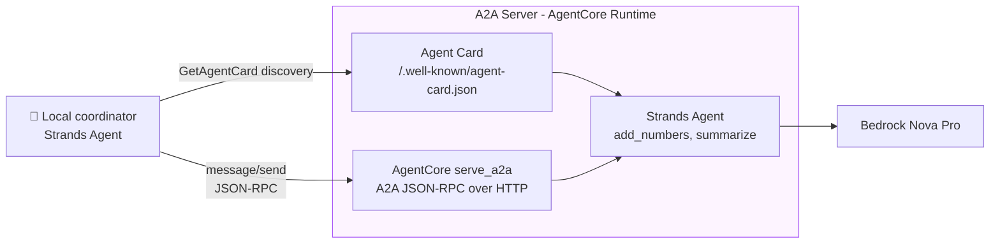
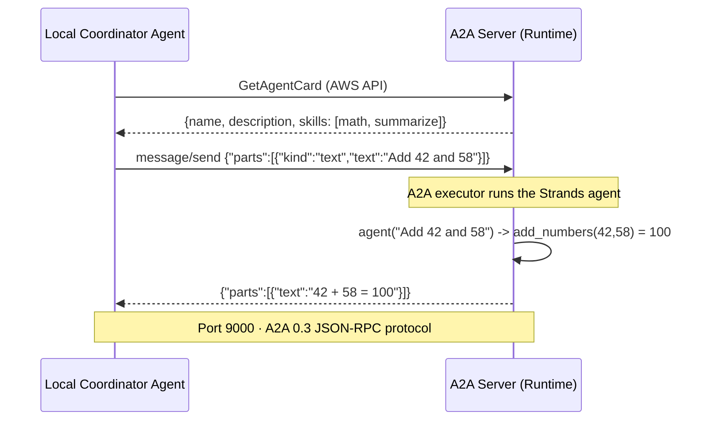
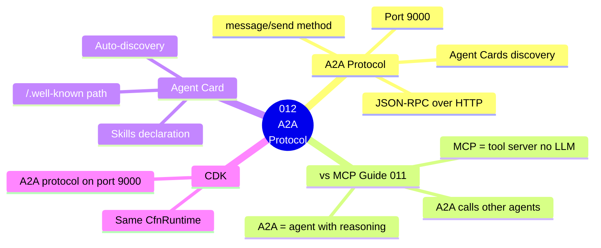

# 012 — AgentCore Runtime: Agent-to-Agent (A2A) Server

## What

Deploy a Strands specialist as an **A2A 0.3 server** on AgentCore Runtime, then
use a second, local Strands coordinator agent to discover and delegate tasks to
it. The specialist exposes an Agent Card and accepts A2A JSON-RPC messages. It
can add numbers or summarize text using Amazon Bedrock.

## Why

A2A (Agent-to-Agent) is an open protocol that lets AI agents communicate with
each other across frameworks, clouds, and vendors. When you deploy an A2A server
to AgentCore Runtime:

- A coordinator agent can discover the specialist's advertised skills and
  delegate tasks using A2A
- You get all AgentCore Runtime benefits: session isolation, auto-scaling,
  observability, no infrastructure management
- The specialist Runtime is explicitly configured for the A2A protocol and its
  required port

## Architecture

### Component Diagram



### Invocation Flow



### Guide Overview



---
## A2A 0.3 Request Flow

```
Client                               A2A Server
  │                                      │
  │── GetAgentCard (AgentCore API) ───────►│  (discover capabilities)
  │◄── AgentCard JSON ────────────────────│
  │                                      │
  │── POST / {"method": "message/send"} ──►│  (submit task)
  │◄── {"result": {"status": "completed"}}│  (task and result)
```

This guide's specialist completes the request before returning the
`message/send` response, so the coordinator does not need to poll with
`tasks/get`.

## Steps

### 1. Install

```bash
pip3 install -r Source/requirements.txt
```

### 2. Run A2A server locally

```bash
bash dev.sh
```

The A2A server starts on port 9000.

### 3. Inspect the agent card

```bash
curl http://localhost:9000/.well-known/agent-card.json | python3 -m json.tool
```

### 4. Test with the A2A client

```bash
# In another terminal (server must be running):
python3 Source/test_client.py
```

This verifies the server's discovery endpoint and JSON-RPC protocol locally.

### 5. Deploy to AgentCore Runtime

```bash
bash deploy.sh
```

### 6. Invoke an A2A task through AgentCore Runtime

```bash
bash invoke.sh "Add 2 and 3."
```

This is the two-agent proof: a local Strands coordinator discovers the deployed
specialist with AgentCore `GetAgentCard`, decides to delegate using its tool,
then sends an A2A JSON-RPC `message/send` through the authenticated Runtime API.
The Runtime specialist responds with a completed A2A task, which the coordinator
uses to answer you. Only the specialist runs in AgentCore Runtime; the
coordinator runs locally and makes its own Bedrock model call.

The AWS identity used by the local coordinator needs permission to call
`bedrock-agentcore:GetAgentCard` and `bedrock-agentcore:InvokeAgentRuntime` for
the deployed Runtime.

## Cost Estimate

**Approximate cost: ~$0.05–$0.15/day**

One Runtime specialist: approximately $0.0000267/session-second, plus Bedrock
inference charges for both the local coordinator and remote specialist. A2A
itself adds no separate charge.

> For current pricing, see the [AgentCore pricing page](https://aws.amazon.com/bedrock/agentcore/pricing/) and [Bedrock pricing](https://aws.amazon.com/bedrock/pricing/). Always run `bash destroy.sh` after testing to stop billing.
## Cleanup

```bash
bash destroy.sh
```

## Agent Card (what the server advertises)

This example shows the URL used by the local development server. The deployed
coordinator discovers the card through AgentCore's `GetAgentCard` API and calls
the Runtime through `InvokeAgentRuntime`.

```json
{
  "name": "guide-012-a2a-server",
  "description": "A2A agent with math and text tools",
  "version": "1.0.0",
  "url": "http://localhost:9000/",
  "capabilities": {
    "streaming": false,
    "pushNotifications": false
  },
  "skills": [
    {
      "id": "add_numbers",
      "name": "Add Numbers",
      "description": "Adds two numbers and returns their sum",
      "tags": ["math", "arithmetic"]
    },
    {
      "id": "summarize_text",
      "name": "Summarize Text",
      "description": "Summarizes text in a requested number of sentences",
      "tags": ["text", "summarization"]
    }
  ]
}
```

## Key Takeaways

1. **A2A enables agent delegation** — the local coordinator discovers and delegates to a remote specialist.
2. **Port 9000** for A2A (different from 8080 used by standard AgentCore agents).
3. **Agent card is the contract** — clients discover capabilities without reading code.
4. **Advertised skills are the contract** — the specialist declares its
   capabilities in the Agent Card; the coordinator uses those capabilities to
   decide when to delegate.

## Next Steps

- **013** — Add streaming support to A2A responses
- **025** — Register this A2A server as a Gateway Runtime target
- **062** — Use this as a specialist in a multi-agent system
